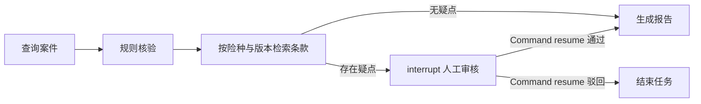

# V0 原型说明

## 架构与工作流

Vue 3 工作台通过 NestJS HTTP API 创建任务并提交审核，通过 SSE 接收实时进度。后端由 LangGraph StateGraph 执行节点，MemorySaver 按任务 ID 保存 checkpoint，AnalysisStore 保存面向页面的任务状态和事件。



节点内的查询、核验、检索目前是直接调用函数，并记录工具执行事件；没有让模型自主选择 LangChain Tools。报告由模板生成，不会向任何模型服务发送数据。

## 接口

| 方法 | 路径 | 用途 |
| --- | --- | --- |
| GET | `/api/cases` | 示例案件列表，含材料字段 |
| GET | `/api/cases/:id` | 案件详情 |
| POST | `/api/analyses` | `{ "caseId": "CASE-2026-001" }` 创建任务 |
| GET | `/api/analyses` | 当前进程的历史任务 |
| GET | `/api/analyses/:id` | 任务状态、疑点、条款、报告、事件 |
| GET | `/api/analyses/:id/events` | SSE 订阅，支持 `Last-Event-ID` |
| POST | `/api/analyses/:id/review` | `{ "decision": "approve", "comment": "审核意见" }`，或 `reject` |

SSE 使用统一 `event: timeline`，`data` 含 `id/type/at/title/detail/data/status`。`type` 区分状态、节点、工具、审核请求、报告和错误。事件 ID 在每个任务内递增，客户端按 ID 去重；已结束任务的流在重放后关闭。游标重放只覆盖当前 API 进程内事件。

接口对不存在的案件/任务返回 404，对无效参数返回 400，对非待审核任务的审核请求返回 409。审核开始时先同步变更任务状态，避免并发重复恢复。

## 三分钟演示

1. `pnpm dev` 启动服务，打开 `http://127.0.0.1:5173`。
2. 选择 `CASE-2026-001`，点击“启动新分析”。核验到“维修发票缺失”和“事故早于保单生效”，并检索到两条 2025-01 版示例条款。
3. 确认没有最终报告，刷新页面，验证任务 ID、时间线和待审核状态保留。
4. 填写审核意见，点击“通过并继续”。验证同一任务产出报告，审核节点和之前的工具事件没有重复。
5. 再次启动该案件，选择“驳回任务”。验证任务结束且不生成报告。
6. 切换到 `CASE-2026-002` 并启动，验证跳过人工审核，生成无规则疑点的报告。
7. 点击历史任务，验证可在各次分析间切换，案件与报告保持一致。

## 可重复验证

```bash
pnpm test
pnpm build
# 保持 pnpm dev 运行，在另一个终端执行：
pnpm smoke
```

- 测试：缺件、日期、版本过滤、暂停/恢复、驳回、重复审核、并行任务隔离。
- 冒烟验证：通过真实 HTTP 与 SSE 验证审核后事件推送、Last-Event-ID 重放和参数错误码。会在内存中创建演示任务。
- 页面验证：已手动检查审核暂停、刷新恢复、通过生成报告、案件切换与常规案件自动完成。

## 持久化和恢复边界

前端 localStorage 只记录案件最近查看的任务 ID；任务、事件和 checkpoint 都在服务端内存。刷新浏览器可以恢复已有任务，重启 API 后无法恢复。页面通过 Vite 的 `/api` 代理访问后端，避免前端写死跨域地址。

interrupt 所在节点在恢复时会重新执行，因此节点中只调用 interrupt 并返回审核值。面向页面的“等待审核”通知在图执行结束、确认 checkpoint 已保存后发送，避免重复通知，也避免提前审核导致状态竞态。参见 [LangGraph interrupts 文档](https://docs.langchain.com/oss/javascript/langgraph/interrupts)。

SSE 的实现采用 NestJS Observable，参见 [NestJS SSE 文档](https://docs.nestjs.com/techniques/server-sent-events)。
