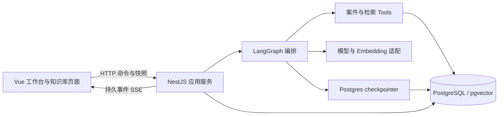
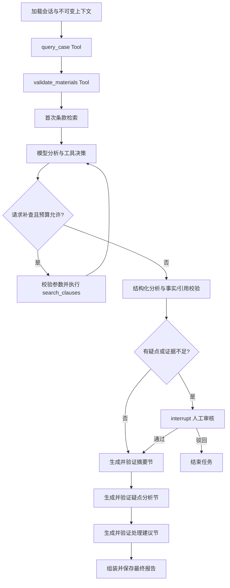

# CasePilot Agent V1 设计方案（已批准，实施中）

日期：2026-10-23  
状态：用户已批准按本方案开发，当前进入 G0 准备与验证。本文中的功能、接口和验收指标是实施目标，不表示已全部实现。

本方案由前端开发、后端开发、测试三个角色分别审查 V0 后汇总。实施继续由三个角色协作；出现影响范围、数据一致性或真实集成的卡点时，暂停相关开发并沟通。模型服务已选定智谱：glm-4.7-flash 负责分析，embedding-3 负责向量化，共用标准 API Key，先使用用户现有额度进行小规模能力验证。

配套文档：[接口与事件契约](V1_CONTRACTS.md)、[测试与验收方案](V1_ACCEPTANCE.md)。原始基线见 [MVP 计划](MVP.md) 和 [V0 功能流程](FUNCTIONAL_FLOW.md)。

## 1. 已批准的设计决定

| 决定 | 推荐方案 | 原因与影响 |
| --- | --- | --- |
| V1 范围 | 以简历三项能力的最小真实闭环为目标；将原 V2 的最小多轮对话、补充检索和持久恢复前置 | 原 V1 只有真实 AI/RAG，不能覆盖简历中的多会话与恢复。此项是明确的范围调整建议，批准前不更改原计划 |
| 条款输入 | 先支持可复制文字的 PDF；每个险种与业务版本对应一份生效 PDF | 能展示真实文档解析和页码溯源；扫描件、加密文件、OCR、多个附件合并留待后续 |
| 模型与 Embedding | 各接入一个确认可用的服务；模型支持真实工具调用和结构化输出，Embedding 使用固定模型与维度 | 不先建设多厂商平台；模型名称、服务地址、凭据与调用预算需要开发前确定 |
| 数据库 | 单个 PostgreSQL + pgvector，同时持久化会话、任务、事件和 LangGraph checkpoint | 减少基础设施种类；优先使用现成数据库，或审阅后通过项目 Compose 启动开发实例 |
| 增量交互 | 报告分三节真实生成、逐节验证后通过 SSE 展示 | 简历要求增量渲染，不要求逐 token。每节独立模型调用，避免原始 JSON 流和未校验正文引入第二套状态 |

这些决定共同构成已批准 V1；相对原 MVP 计划前置的范围已纳入本次实施。实现结果仍须通过阶段验收，不能直接按计划声明完成。

## 2. 当前基线与真实缺口

| 维度 | V0 已有 | V1 需要补齐 |
| --- | --- | --- |
| 工作流 | 真实 StateGraph、条件分支、interrupt/Command | 真实模型节点、Tools 协议、受限补充检索 |
| 案件材料 | 两个虚构案件、结构化字段、三项规则 | 材料 ID、字段来源、规则证据定位及冲突测试样例 |
| 条款 | 内存关键词匹配、险种/版本筛选 | PDF 解析、分块、真实 Embedding 与 pgvector |
| 报告 | 确定性模板和条款 ID/原文 | 模型分析、事实与引用校验、真实分节生成 |
| 交互 | 单任务 SSE 时间线、审核、历史切换 | 对话消息、工具状态卡片、生成中报告、引用定位 |
| 恢复 | 进程内任务和 MemorySaver | 数据库任务与 checkpoint、重启后的审核恢复 |
| 工程结构 | 页面和工作流逻辑较集中 | 按职责拆分、共享传输契约、前端与基础设施测试 |

现有测试文件定义了 7 个 V0 用例，并有 HTTP/SSE 冒烟脚本；它们不证明真实模型、向量检索或跨进程恢复已经通过。本轮未重新执行测试。

## 3. 简历能力与 V1 交付对照

| 简历要求 | V1 对应交付 | 核心验收 |
| --- | --- | --- |
| 材料合成、案件查询 | 查询并汇总结构化案件及材料事实，生成带来源的事实快照 | 每项事实可定位案件字段或具体材料字段 |
| LangGraph 多节点 Agent | 明确的查询、校验、检索、分析、审核和报告节点 | 可观察不同路径，图定义与业务逻辑分离 |
| 封装案件查询、材料校验 Tools | LangChain `tool` 与输入 Schema；节点实际调用业务工具 | 不再仅显示名为 Tool 的静态文案 |
| 确定性缺件与跨来源冲突 | 保留并强化纯函数规则；规则发现与模型推断分开保存 | 模型不能覆盖、删除或随机改写规则事实 |
| 动态分支与补充检索 | 模型按疑点请求只读检索，后端执行有预算的循环 | 初检充分、补检、补检不足三条路径可复现 |
| LangChain + pgvector RAG | PDFLoader、文本分块、Embedding、参数化向量检索 | 实际向量入库与语义检索；严格隔离险种和版本 |
| 条款引用与依据溯源 | 报告结论关联事实 ID、检索块 ID；来源提供文档、版本、页码与原文 | 引用存在、范围正确，语义支持另做评测 |
| SSE 增量渲染和执行追踪 | 真实分节结果、工具开始/完成/失败、耗时及时间线 | 第一节在后两节生成完成前已显示 |
| interrupt 人工审核与恢复 | 持久 checkpoint、审核幂等、重启对账 | 同一任务恢复，无重复审核或重复最终报告 |
| 多轮对话与多会话切换 | 案件会话、独立回合任务、上下文隔离 | 追问可用前文，不污染其他会话 |
| 历史任务管理 | 持久消息、任务、报告和审核记录 | 重启后可查看原结果与原引用 |

材料合成在本阶段指已有结构化事实的整理和来源关联，不扩展为 OCR。案件仍由演示种子提供，新增跨材料冲突与证据不足样例；不建设案件录入后台。

## 4. 架构与维护原则

采用 Vue 3 + TypeScript、NestJS、LangGraph.js、LangChain.js、PostgreSQL/pgvector 和 SSE。V1 保持一个前端应用、一个后端进程、一个数据库，不引入 Redis、BullMQ、微服务或通用 Agent 平台。



维护原则：

- Controller 只处理输入、状态码和调用应用服务；不拼提示词、不写 SQL、不直接编排图。
- 规则、引用检查、路由条件、前端事件归并保持纯函数，方便独立理解与测试。
- 图文件表达节点与边；节点实现、Tools、模型适配和提示词分别存放。
- 前后端共享传输 DTO/Schema，前端不再从后端源码目录导入内部实体。
- 一个状态只有一个明确的权威来源。数据库快照是页面实体的权威，连接状态不混入业务状态。
- 只为确有替换需要的模型、数据库边界保留接口，不增加万能工厂、插件注册器或规则 DSL。
- 对外异步操作必须有终态和错误归宿，不允许用静默降级掩盖真实依赖失败。

## 5. 三角色分工与协作方式

| 角色 | 主要责任 | 交付物与边界 |
| --- | --- | --- |
| 前端开发 | 拆分工作台、知识库导入、对话、报告、引用、审核和 SSE 状态 | 主要维护 `apps/web`；不自行改变业务契约或在页面推断审核结果 |
| 后端开发 | 数据库迁移、导入检索、模型与 Tools、图、审核恢复、接口与事件 | 主要维护 `apps/api` 和共享契约；新增契约须同步前端与测试 |
| 测试人员 | 测试数据、契约测试、流程与故障验证、真实模型/RAG 评测、可读性审查 | 维护测试和夹具；明确区分 stub、数据库集成与真实服务验收 |

由主代理负责整合设计和联调。实施前先冻结第一版契约，之后三角色按所有权协作；共享文件由单一责任人修改。发现接口或状态机需要调整，先更新文档及影响范围，再同步实施。

每个阶段完成后进行交叉审查：测试检查异常路径与可验证性；前端、后端相互检查契约使用和模块边界。可读性问题与功能缺陷同样阻止阶段通过。

建议目录仅表达职责，不要求为每个目录预建无实际用途的文件：

```text
apps/web/src/
  pages/           WorkbenchPage、KnowledgePage
  components/      案件导航、对话、时间线、工具卡片、审核、报告、引用
  composables/     useWorkbench、useAnalysisStream、useKnowledgeImport
  api/             HTTP 与各业务资源客户端
  domain/          事件归并与页面状态纯函数

apps/api/src/
  cases/           案件查询、事实快照、规则
  knowledge/       PDF 导入、分块、索引发布、受限检索
  analyses/        会话、消息、任务、审核、报告与执行器
  workflow/        图、节点、Tools、状态与引用检查
  model/           单一已确认服务的模型与 Embedding 适配
  database/        连接池、事务、迁移、checkpointer 初始化

packages/contracts/  前后端共享的纯 DTO 与运行时 Schema
tests/               跨应用验收与固定评测数据
```

## 6. 核心实体与不变条件

只保留 `caseId → conversationId → analysisId` 三层业务标识。`analysisId` 延续现有分析任务，不再创建一套平行的 run/session 命名。

| 实体 | 关键内容与约束 |
| --- | --- |
| Case / Material | 案件事实、材料 ID 和结构化字段；案件有数据版本 |
| Conversation | 永远属于一个案件；可创建多个独立会话 |
| Message | 属于一个会话；关联任务；用户问题与已完成助手回答分别保存 |
| Analysis | 一次初始分析或追问；固定案件快照、知识索引、上下文消息 ID、模型/提示词/Schema 版本 |
| Fact / RuleFinding | 事实 ID、来源、值；规则发现关联事实与来源值 |
| ModelFinding | 待核查推断、证据充分性、事实引用、条款引用与下一步建议 |
| Citation | 来自该任务检索白名单；文档名、页码和原文由后端填充 |
| Review | 对应具体中断点；同一中断只接受一个审核决定 |
| ReportSection / Report | 按固定节顺序生成；最终报告只读且只定稿一次 |

一次追问创建新的 `analysisId`，从所属会话的已完成消息和前序报告加载上下文；不会复用上一回合的 review/findings 等图状态。人工审核恢复则始终使用原 `analysisId`，图的 `thread_id=analysisId`。

会话在首轮分析时固定案件数据版本与知识 generation，后续追问沿用；每轮任务保存自己的引用与上下文快照。需要使用更新后的案件或条款时，新建会话，避免在同一对话里悄悄改变事实或依据。

每个会话最多一个活动任务，等待审核也占用活动位置，通过数据库约束执行。同会话未结束前新问题返回冲突；不同会话可以切换并独立执行。单进程先限制最多两个执行中的任务，等待审核不占模型调用并发名额。

用户追问中的新说法只是用户陈述，不会自动改写案件事实。涉及日期更正等内容时，回答应说明需核实的来源；当前版本不提供聊天直接修改材料的工具。

## 7. 条款知识库与索引发布

### 7.1 输入和处理

推荐首版仅接收文字型 PDF，建议限制为 10 MiB、100 页以内；限制属于设计默认值，开发时验证后固化。扫描件、加密、损坏、无有效正文文件返回明确错误，不自动启用 OCR。

上传 → 文件校验与 SHA256 → LangChain PDFLoader 按页读取 → 按条号/段落优先分块 → Embedding 小批量生成 → 写入待发布 generation → 校验全部结果 → 原子发布。

分块初值建议为 800 字符、重叠 120 字符。页内分块保留真实页码、顺序和正文；跨页条款可通过相邻块补充上下文，不把跨页文本伪装成单页原文。文档不能可靠提取条号时，使用实际页码与块位置，不让模型编造条号。

### 7.2 版本与原子发布

业务版本（例如 `2025-01`）与索引 generation 是两个维度：相同业务版本重新上传或重建，也产生独立 generation。

- 每个 `productCode + clauseVersion` 保存一个生效 generation 指针；V1 每个 generation 对应一份完整 PDF。
- 已有生效版本时，界面明确提示替换；提交当前 generation 作为预期值，避免并发覆盖。
- 解析或 Embedding 失败只影响待发布 generation，不改变旧指针。
- 仅全部块和向量写完并校验后，才在一个事务内标记 ready 并切换指针。
- 单进程启动时，将上次中断于 parsing/chunking/embedding 的未发布 generation 标为 failed / INDEXING_INTERRUPTED，保持旧指针；由用户显式 retry 创建新 attempt，仅重建该未发布 attempt 产物，不更改已发布块。尚未执行的 queued 导入可继续排队。
- 文件、元数据和处理配置一致的重复导入复用已有记录，失败重试使用显式新 attempt，不制造重复可见块。
- 创建任务时固定 generation；正在运行和已完成任务不受后续发布影响。V1 不删除被任务引用的旧文件和索引。

### 7.3 检索策略

采用参数化 SQL 的 pgvector 精确余弦检索。查询必须带服务端固定的险种、业务版本、generation 和 Embedding profile，先限制候选集合再排序；初期不引入 HNSW、混合检索或重排模型。

一个部署先使用一个固定 Embedding profile，包含 provider、model、维度及配置指纹。`vector(D)` 的 D 在迁移前确认；更换模型或维度必须显式重建索引，不能静默混用或运行时自动改表。

建议每次 topK=4，最多保留 12 个去重片段。距离值用于检索排序，不作为案件结论置信度。相关性阈值须经固定评测集校准；相似度高也不代表片段支持结论。

没有正确险种/版本的生效索引时，不启动真实分析并给出可操作提示；存在索引但没有足够相关依据时，进入证据不足分支，不回退旧版或 V0 关键词库。

## 8. Agent、规则与真实 Tools

三个 Tools 使用 LangChain 工具接口和输入 Schema，调用同一套业务服务：

| Tool | 使用方式 | 限制 |
| --- | --- | --- |
| `query_case` | 图中必经节点实际调用 | 案件 ID 从服务端任务上下文注入 |
| `validate_materials` | 图中必经节点实际调用全部规则 | 无模型决策绕过，不修改案件 |
| `search_clauses` | 初检由图调用；补检由模型提出真实工具调用 | 模型仅提供问题和疑点，不可修改险种、版本、generation |

现有三项规则保留；日期先做有效性校验，区分“缺失”“无效”“互相冲突”。跨来源冲突列出具体材料和值，并检查材料日期与案件日期的一致性；不由模型挑选某个来源为真。



分析模型可绑定受限的检索 Tool，图负责实际执行请求。模型结束工具回合后再生成受 Schema 约束的分析结果，不要求选定服务在同一个请求中同时支持工具、原生 JSON 和 token 流。

建议全局预算：初检 1 次、补检最多 2 次，每次补检只允许一个查询；模型请求最多 8 次，含结构修复和三节报告；同类结构修复最多一次。工具参数越界、重复查询或未增加新依据时提前停止补查。失败与重试同样计入预算，不通过节点重试绕开全局限额。

预算采用服务端持久账本：外部模型或检索调用前，事务校验并预占次数，记录稳定逻辑调用键与 attempt。审核、重启和恢复不重置计数；请求结果未落库的模糊外部调用仍占用一次额度，重新请求需再占额度。账本与有界节点产物可保存在 analyses 的 JSONB 字段中，不另建通用计费系统。

分析阶段必须为尚未生成的三节报告预留至少三次模型调用，结构修复也占全局额度。补充检索次数耗尽时保存 `insufficient_evidence`，转人工核查；如果全局模型额度已经不足以完成剩余阶段，则明确失败为 MODEL_BUDGET_EXHAUSTED，不能通过审核重开预算。原始模型思考过程不展示，页面只显示工具、依据和结构化分析摘要。

## 9. 报告、引用和真实增量

分析结果必须区分已确认事实、规则发现、模型待核查推断。引用只能选择当前任务的事实与检索片段 ID；页码、文档名和原文由后端解析回填。

后端检查事实 ID、引用 ID、险种、版本、generation 和规则保留情况；不合法输出最多修复一次，仍不合法则明确失败。引用 ID 合法不能证明语义支持，后者由固定样本与人工标注评测。

报告分为摘要、疑点分析、处理建议三节。每节对应独立图节点和真实模型生成，生成一节后完成 Schema 与引用检查、持久化、推送 `report.section`，然后生成下一节。已有合法规则事实和来源作为受控输入保留。

前端按 `sectionKey` 更新内容，并显示“生成中，尚未定稿”。第三节完成后，由服务器组装完整报告并发送 `report.completed`。中间一节失败时，前面的内容仍标记未定稿，不能显示最终完成或充当完整报告。

例如摘要已提交而疑点节失败：保留摘要节，但 `report=null`、`assistantMessageId=null`，任务为 failed 或经明确判断可恢复的 recoverable。恢复复用已提交摘要，不再次生成、提交或重复发布该节业务事件。

本版不实现 token 草稿流，也不把整份结果生成完后拆字播放。第一节必须能在后续节的实际调用结束前显示，作为增量验收证据。

## 10. 持久化、审核与崩溃边界

建议使用 `pg` 连接池、参数化 SQL 与版本化迁移，不为本阶段额外引入 ORM。业务表覆盖 cases、conversations、messages、analyses、analysis_events、analysis_reviews、analysis_commands、knowledge_documents、knowledge_generations、clause_chunks、knowledge_publications；checkpoint 表由官方 PostgresSaver 管理和初始化。

最终表名可在契约冻结时统一，但必须具备以下约束：

- 会话活动任务部分唯一约束；事件 `(analysisId, seq)` 唯一。
- 每个中断点只有一个审核决定；同一幂等键不可绑定不同请求。
- 报告节、工具结果和关键节点产物保存稳定业务键；重新执行先读取已提交产物，避免业务结果重复提交。
- 任务状态、页面快照、对应正式事件在同一业务事务中更新。
- LangGraph checkpoint 与业务事务是独立边界，不能宣称两者全局原子提交。

审核接口在事务中检查状态及中断标识，保存决定、待执行 resume 命令和审核接受事件，再返回 202。执行器按任务串行消费命令，使用相同 thread ID 恢复。interrupt 节点只负责暂停和返回审核值，不发事件、不调用模型；确认 checkpoint 持久化后才发布待审核通知。

| 崩溃位置 | 恢复行为 |
| --- | --- |
| 审核已接受，恢复命令未执行 | 重启后读取持久命令，继续执行已接受的同一决定 |
| 图仍停在原中断点 | 用对应审核值执行 Command resume |
| 图已越过审核点 | 继续后续节点，不再次提交审核值 |
| 节或最终报告已提交，事件连接未收到 | 从数据库游标补发，不重新生成业务结果 |
| checkpoint 已推进，业务快照尚未同步 | 从 checkpoint 对账，按稳定业务键补写投影和事件 |
| 外部模型完成，结果尚未持久化 | 可能需要再次调用并产生费用；不承诺模型调用恰好一次 |
| 两套持久状态无法安全对账 | 标记需要恢复处理，停止猜测重放并提示原因 |

常规运行中强停后，不无限自动重试模型：将未完成任务标记为 `recoverable`，通过明确恢复操作从最后确认位置继续。已持久接受的 start/resume 命令可继续完成；矛盾或预算不明时暂停任务。最终有效报告只定稿一次，SSE 提供至少一次传递并由前端去重。

## 11. 前端交互与异步隔离

保留工作台，新增知识库页面。工作台提供案件/会话导航、对话消息、当前任务时间线、工具卡片、审核表单、增量报告和引用面板。历史回答不因追问被覆盖，工具卡片以 `toolCallId` 配对并显示耗时。

前端 API 请求、SSE 和审核提交均绑定 `selectionEpoch + conversationId + analysisId`。切换时终止旧详情请求和连接；成功、失败及 finally 回调都检查所属作用域，不能用旧回调覆盖当前页面、错误或 loading。审核意见按具体任务及中断点存放。

重新进入任务时先获取一致快照和 `lastEventSeq`，再从 `?after=lastEventSeq` 订阅。新建 EventSource 不会自动继承上一连接的游标；同一连接重连时再使用 `Last-Event-ID`。

快照同时包含案件事实与执行时间线投影。查看旧任务时，案件摘要和材料目录采用任务快照，不能被当前案件接口覆盖；恢复旧任务时，既有节点和工具卡片先从快照还原，再接续新事件。

报告节、状态和游标先持久化后推送；服务端直接按序查询同一事件表作为 SSE 来源，避免“历史补发切换到内存实时订阅”的空窗。前端遇到事件重复按 ID 去重，遇到缺口重新取快照。具体规则见 [契约文档](V1_CONTRACTS.md)。

引用面板显示真实文件名、业务版本、generation、页码、原文与相邻块。先定位系统保存的正文即可，不建设复杂 PDF 阅读器。渲染模型内容默认禁用原始 HTML。

## 12. 配置、环境与失败语义

后端配置项包括数据库连接、聊天服务地址/模型/Key、Embedding 服务地址/模型/Key/维度、超时与预算。实际 Key 仅放服务器环境变量或本地未跟踪文件，不放前端、不写文档、不要求贴到对话。

批准开发后先做小型能力验证：模型能完成真实工具调用与结构化输出；Embedding 维度符合配置；PostgreSQL 可启用 pgvector 和 checkpointer 迁移。验证结果记录实际包版本，不通过全面升级依赖来碰运气。

设计审阅时尚未验证数据库和模型；实施后已启动独立 CasePilot PostgreSQL/pgvector，并完成智谱工具调用、JSON 输出与 1024 维 Embedding 的真实探测。checkpoint 持久化与业务链路仍须独立验证，阶段证据以 [实施记录](V1_IMPLEMENTATION_STATUS.md) 为准。真实质量评测执行前仍需确认批量调用预算；不因已有免费额度就无限调用。

预检失败时返回明确配置或依赖错误，不把 V0 模板、固定向量、关键词检索伪装成真实能力。模型分析中遇到无相关依据属于业务结果；服务超时、结构化失败和引用越界属于明确失败路径。

本阶段使用虚构案件与演示条款完成集成，模型不直接执行赔付或修改案件。导入文档作为检索数据，不能覆盖系统规则或工具权限。

## 13. 开发顺序与质量门禁（批准后执行）

| 阶段 | 后端 | 前端 | 测试与退出条件 |
| --- | --- | --- | --- |
| G0 前提与契约 | 验证模型、Embedding、数据库，冻结 Schema/状态机 | 审查交互所需字段 | 真实能力检查通过；缺依赖则暂停，不记通过 |
| G1 结构整理 | 拆分规则、服务、图与持久化边界 | 拆分 App.vue 与 API/SSE 逻辑 | V0 回归与类型检查通过，可读性评审通过 |
| G2 知识库 | PDF→分块→Embedding→原子发布→检索 | 导入、状态、引用面板 | 实际 pgvector 集成与版本隔离通过 |
| G3 Agent | 真 Tools、受限补检、结构化分析和引用验证 | 对话与工具卡片，可按契约夹具并行 | 真实模型路径、无依据与预算上限通过 |
| G4 恢复与增量 | 持久会话、审核命令、三节生成和事件流 | 快照恢复、切会话、审核与分节报告 | 重启恢复、并发审核和重连故障测试通过 |
| G5 联合验收 | 修复实现问题，记录实际配置 | 验证真实页面流程 | 真实服务评测、浏览器 E2E、三角色可读性评审全部通过 |

文档、类型、构建、相关测试与真实验收缺一不可。stub 仅用于开发和确定性测试，不替代真实能力门禁。不因追求进度跳过引用、隔离或恢复错误，也不以覆盖率数字替代可读性审查。

## 14. 何时暂停并与用户沟通

以下情况暂停受影响的开发，不擅自换技术或降低完成标准：

1. 模型或 Embedding 不可用、所需能力不支持、预算未确定或真实调用持续失败。
2. 数据库部署、扩展或迁移受阻，需要安装软件、改用其他存储或扩大环境范围。
3. 必须改为 OCR、多文档合并、分布式队列等超出已批准范围的实现。
4. 出现跨会话污染、错误版本引用、重复审核恢复，或持久状态无法安全解释。
5. 为完成能力需要明显破坏已约定的模块边界、增加通用框架或持续堆叠补丁。

沟通内容固定为：已复现的现象、证据、影响范围、可选方案和推荐取舍。等待用户决定后继续相关开发。普通实现缺陷可在既定方案内修复，但上述架构、数据或验收卡点不得自行绕过。

不纳入本次：OCR、生产权限、多租户、自动赔付、分布式工作流、批量案件录入、复杂规则后台和模型厂商管理平台。

## 15. 设计依据

- LangGraph 中断需要同一 thread ID 恢复，节点会重新执行，因此中断节点避免副作用：[Interrupts](https://docs.langchain.com/oss/javascript/langgraph/interrupts)。
- 持久 checkpoint 采用官方 PostgreSQL 实现并显式初始化：[Memory / PostgreSQL](https://docs.langchain.com/oss/javascript/langgraph/add-memory)。
- 真实工具采用带输入 Schema 的 LangChain Tool：[Tools](https://docs.langchain.com/oss/javascript/langchain/tools)。
- 模型输出以受约束结构作为后端校验边界：[Structured output](https://docs.langchain.com/oss/javascript/langchain/structured-output)。
- PDF 解析能力以锁定版本的 Loader API 和实际样本验证为准：[PDFLoader](https://reference.langchain.com/javascript/langchain-community/document_loaders/fs/pdf/PDFLoader)。
- 初期精确向量检索及距离定义参考：[pgvector](https://github.com/pgvector/pgvector)。
- HTTP 单向事件通道参考：[NestJS SSE](https://docs.nestjs.com/techniques/server-sent-events)。

上述能力用于设计判断，不代表当前仓库已安装对应依赖或完成兼容性验证；具体版本在 G0 确认后固定。
