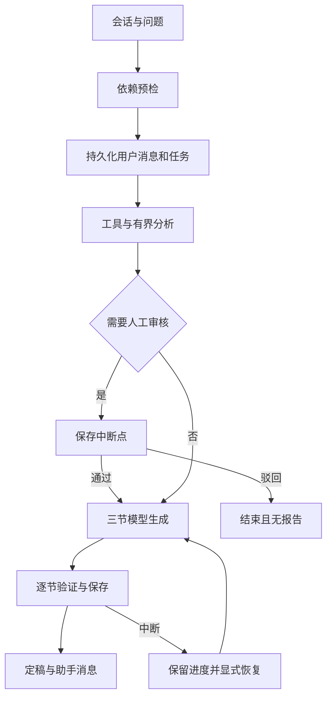

# 功能流程

当前工作台使用 V1 会话与审核协议。旧版模板报告保留只读；新任务通过真实模型适配器、案件工具和已发布知识索引执行。安装启动见 [项目说明](../../项目说明.md)，验证边界见 [实施状态](../开发/实施状态.md)。

## 启动前提

新分析需要 PostgreSQL/pgvector、正确的模型配置，以及与案件险种和业务版本匹配的 ready 生效知识索引。模型和 Embedding 使用既定服务，不自动回退关键词或模板。

先在“条款知识库”导入含可复制文字的 PDF，选择险种与条款版本，等待索引就绪并发布。已有生效版本时需确认替换；构建失败不影响旧发布。生产导入和分析可能消耗供应商额度。

内存模式只提供案件查询、配置检查等只读能力，新建会话和分析返回明确的依赖错误。案件材料目录仍是虚构的结构化示例，不能上传真实案件附件或执行 OCR。

## 操作步骤

1. **查询案件**：在工作台左侧按赔案号、报案号或车牌号查询 C01–C03，也可按结案日期、原档案人伤声明和审查进度筛选。无匹配、数据未导入和加载失败分别提示。
2. **查看摘要和完整详情**：选择案件后，工作台主区域只展示金额、赔案范围、车辆和状态摘要；点击“查看完整详情”进入独立页面，查看事故和范围、本车/第三方、目标/关联赔案、交强险/商业险及其承保险种、损失金额、原理算核赔支付记录、时间线、资料缺口和材料目录。材料可按类别和关联对象筛选，并在有真实证据页码时打开对应 PDF 页；返回工作台后保留原查询和选择。
3. **打开历史分析**：从左侧历史任务进入原有分析工作台；任务顶部使用其固定案件快照。C01–C03 本阶段只提供查询和详情，不显示启动审查入口。
4. **创建会话**：填写问题后点击“发送并分析”；没有当前会话时自动创建会话。顶部“启动新分析”创建另一个独立会话。
5. **跟踪执行**：查看查询案件、核验事实与材料、条款检索、模型分析等执行记录。卡片由实际持久调用记录产生，包含尝试次数、状态及耗时。
6. **核验疑点**：规则发现保留原值和 factRefs；模型发现单独标注推断及证据状态。规则疑点、模型疑点或依据不足可能要求人工审核。
7. **人工审核**：填写意见，通过继续生成报告，驳回结束当前任务。通过表示允许继续分析，不表示批准赔付；原始疑点不会被删除。
8. **阅读分节报告**：摘要、疑点与依据、处理建议逐节显示。未定稿时保留进度提示，三节完成后才出现正式报告与完整助手消息。
9. **查看引用**：点击章节的“查看依据”，展示该任务关联的 PDF 文件、真实页码、原文及固定知识版本，以及同版本文档的前后各一段；边界明确提示。相邻段落仅辅助阅读，不自动成为报告证据。
10. **继续追问与恢复**：完成回合后可继续提问；可恢复任务复用已保存章节、调用结果和原预算。失败与未完成回答不混入上下文。

同一会话存在排队、执行、待审、恢复中或可恢复任务时，不能提交下一问题；其他会话独立。切换页面只关闭当前订阅，不取消后台任务。

## 数据与协议

创建分析、审核和恢复均返回 202，表示命令已持久接受。会话创建返回 201。客户端先取任务快照，再从 lastEventSeq 订阅 SSE；重复事件去重，缺号或连接故障重新读取快照。409 冲突后以服务器状态为准，不猜测审核结果。

完整字段见 [接口与事件契约](../设计/接口与事件契约.md)，运行时校验来源是 Python Pydantic 与生成的 TypeScript/Ajv 契约。

## 当前限制

C01–C03 是虚构演示数据。本阶段只接通其查询、只读详情和案件 PDF 查看，未接通启动审查；系统也没有真实案件写入、角色权限或自动赔付功能。原有 V0/V1 历史分析仍可查看。结构与引用白名单校验已经实现，真实供应商质量、检索命中率与引用语义支持仍需单独验收。旧截图仅反映对应历史版本，不能作为当前真实模型效果证据。
