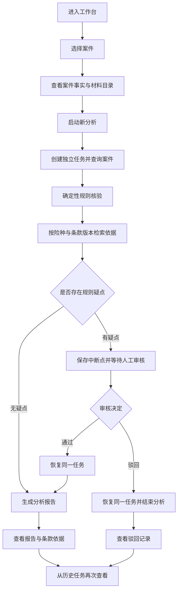
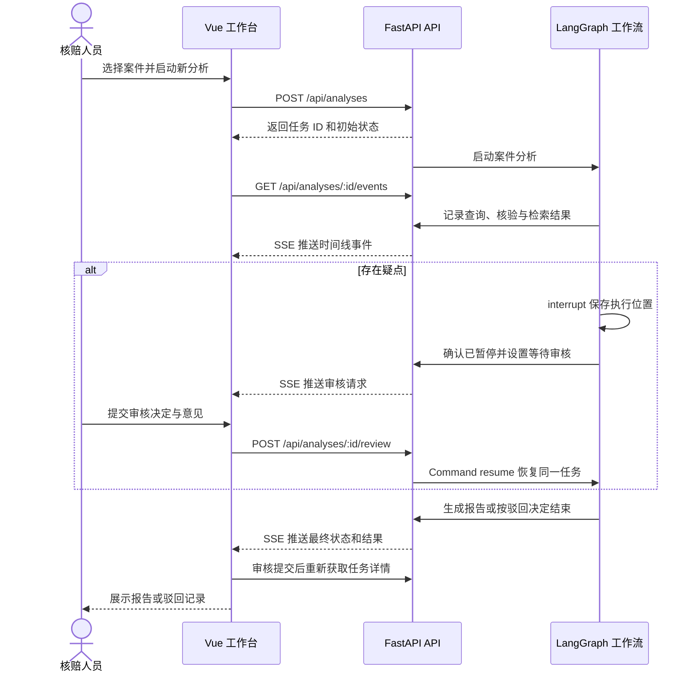

# CasePilot Agent 项目功能流程说明

> 当前案件分析为 V0，另已实现独立的 G2 条款知识库。本文区分实际行为和后续规划；安装运行见 [项目说明](../../项目说明.md)。

## 1. 项目定位

CasePilot Agent 面向核赔人员的案件辅助分析场景，将案件事实、材料校验、条款依据、人工审核和分析报告串联为可追踪的工作流。

当前原型的目标是验证：一件案件能否从分析发起开始，经过规则检查和条款检索，在需要时暂停等待人工处理，再继续生成具有依据的报告。

当前案件流程采用真实的 LangGraph 图执行、interrupt 中断恢复与 SSE 事件推送。案件及分析引用的条款均为虚构示例；分析仍采用关键词检索和模板报告。独立知识库已支持 PDF/向量索引，但尚未接入案件分析，真实模型分析与多轮对话仍待开发。

## 2. 使用角色与页面功能

当前原型以单个核赔人员的操作流程为基础，未实现登录、角色权限或多人审批分工。

| 页面区域 | 用户可执行的操作 | 展示结果 |
| --- | --- | --- |
| 案件中心 | 选择待分析案件 | 案件编号、申请人、事故日期、申请金额 |
| 案件摘要 | 查看基础事实并启动新分析 | 材料数量、保单生效日期、条款版本 |
| 材料目录 | 查看已提供的材料名称 | 索赔申请书、事故认定书、定损单、维修发票等 |
| 执行时间线 | 跟踪当前任务的执行进展 | 节点结果、工具执行摘要、审核通知和完成事件 |
| 人工审核 | 填写意见，通过或驳回任务 | 待核验疑点及审核后的任务状态 |
| 分析报告 | 阅读结果及条款原文 | 案件摘要、疑点清单、处理建议、条款依据、审核意见 |
| 历史分析任务 | 切换到已有任务 | 对应案件的历史时间线、状态及已有报告 |

材料目录中的文件名是示例数据标签，当前不支持上传、下载或在线预览真实 PDF。

## 3. 整体业务流程

整个执行过程中，后端持续记录事件，前端通过 SSE 更新当前任务的时间线。规则校验、条款检索和报告生成的结果由后端产生，关闭页面不会主动取消任务。

## 4. 各阶段功能说明

### 4.1 进入工作台与选择案件

页面加载时获取案件列表和后端存储中的历史任务。如果存在可恢复的历史记录，页面重新读取任务详情；否则展示待启动状态。

用户选择案件后，可以查看申请金额、事故日期、保单生效日期、条款版本和材料目录。切换案件会关闭原任务的页面订阅，并在存在相关历史记录时读取该案件的任务。

输出：当前案件上下文，以及可查看或可新建的分析任务。

### 4.2 创建分析任务

用户点击“启动新分析”，前端提交案件 ID。后端确认案件存在后，生成唯一任务 ID，将状态设置为 `running`，记录“分析任务已创建”事件，并启动工作流。

每次启动都会产生新任务，不会覆盖之前的分析结果。一个案件可以对应多次分析任务。前端随后订阅该任务的 SSE 事件。

输出：任务 ID、初始状态和初始时间线。

### 4.3 查询案件

工作流以启动时传入的案件数据作为输入，读取案件及材料信息，记录案件查询完成和查询工具执行事件。

| 数据类别 | 当前输入字段 |
| --- | --- |
| 案件标识 | 案件 ID、申请人 |
| 保单信息 | 险种编码、条款版本、保单生效日期 |
| 索赔信息 | 事故日期、申请金额 |
| 材料信息 | 材料类型、材料名称、预先提取的结构化字段 |

当前没有连接真实案件系统，也没有在该节点执行 OCR 或文件解析。

### 4.4 确定性规则核验

系统检查结构化案件字段与材料字段，输出疑点清单。规则执行不依赖模型生成结果。

| 规则 | 触发条件 | 疑点级别 | 输出说明 |
| --- | --- | --- | --- |
| 维修发票缺失 | 材料列表中不存在 `repair_invoice` | medium | 无法核验实际修复费用 |
| 事故早于保单生效 | 案件事故日期早于保单生效日期 | high | 提示核验事故时间与责任起期 |
| 跨材料事故日期冲突 | 各材料中已提供的事故日期存在多个不同值 | high | 列出材料中出现的不同日期 |

每条疑点包含规则编码、级别、标题和详细说明。页面主要展示疑点标题和说明。

当前分支条件为“疑点数量是否大于 0”，并非只有 high 级别才进入人工审核。申请金额与定损金额虽然存在于示例数据中，尚未实现差额核验规则；当前规则也不覆盖全部理赔责任判断。

### 4.5 条款检索

系统使用案件的险种编码与条款版本先筛选条款，再使用疑点标题、说明和编码匹配候选条款的预设关键词。

处理顺序如下：

1. 筛选与案件 `productCode` 相同的条款。
2. 筛选与案件 `clauseVersion` 相同的条款版本。
3. 对候选条款进行关键词匹配并计分。
4. 排除零分条款，按得分从高到低返回依据。
5. 将条款 ID、标题、原文和匹配分数写入任务。

无疑点案件使用“损失核定、金额”作为默认检索词。匹配分数是关键词命中数，不是向量相似度或结论置信度。

输出的依据用于报告展示。当前不存在“必须检索到条款才能继续”的门槛；未匹配到条款时仍可能继续流程，检索结果不代表条款库已经完整。

### 4.6 动态分支与人工审核

条款检索结束后，工作流根据疑点清单选择下一步。

| 条件或操作 | 系统行为 | 用户可见结果 |
| --- | --- | --- |
| 无疑点 | 跳过人工审核，直接生成报告 | 状态从分析中变为已完成 |
| 存在疑点 | 进入 `human_review`，调用 interrupt，保存执行位置 | 展示待审核状态和疑点清单 |
| 审核通过 | 使用同一任务 ID 和审核意见恢复图执行 | 继续生成报告，并保留原疑点 |
| 审核驳回 | 恢复图执行并进入结束分支 | 状态变为已驳回，不生成报告 |

审核意见可为空，最长 2000 字。只有 `waiting_review` 状态接受审核；其他状态的审核请求被拒绝，避免重复恢复任务。

审核通过表示允许继续分析，不代表认可全部事实或批准赔付。当前审核不能编辑案件字段、补传材料或消除疑点；驳回后也不能在原任务中再次审核，需要启动新分析。

### 4.7 生成分析报告

无疑点案件或审核通过的案件进入报告生成阶段。

| 报告部分 | 内容来源 |
| --- | --- |
| 案件摘要 | 申请人、申请金额、材料数量 |
| 疑点清单 | 确定性规则核验结果 |
| 处理建议 | 根据疑点编码匹配的模板 |
| 条款依据 | 检索得到的条款 ID、标题与原文 |
| 审核意见 | 人工审核通过时填写的意见，如有 |

当前建议生成的优先级为：

1. 命中“事故早于保单生效”：建议暂缓赔付并核验事故时间与保险责任起期。
2. 存在其他疑点：使用“补齐材料后复核赔付金额”的通用模板。
3. 无规则疑点：提示进入常规核赔。

这些是流程演示用的模板输出，不是模型推理结论。报告生成后，任务变为 `completed`，后端推送报告完成事件，前端展示完整报告并关闭该任务的实时连接。

### 4.8 历史查看与刷新恢复

用户可点击历史任务重新获取状态、事件和报告。切换到仍在运行或等待审核的任务时，页面重新订阅事件；查看已经结束的任务时，直接展示已有结果。

浏览器本地仅记录案件对应的任务 ID。任务主体、事件和 LangGraph checkpoint 根据配置保存在内存或 PostgreSQL 中：

- 刷新页面后，可重新读取仍存在的任务。
- 切换案件不会取消原任务。
- 断开页面事件流不会暂停后端执行。
- 内存模式在 API 进程重启后丢失任务及中断点；PostgreSQL 模式支持原任务、事件和待审核中断点恢复。
- 历史列表不具备跨浏览器全局实时刷新；重新读取任务时以服务端状态为准。

## 5. 任务状态流转

| 状态 | 中文含义 | 进入条件 | 后续流向 |
| --- | --- | --- | --- |
| `running` | 分析中 | 创建任务，或提交有效审核后恢复 | 等待审核、完成、驳回或失败 |
| `waiting_review` | 等待审核 | 图已保存人工审核中断点 | 提交审核后回到分析中 |
| `completed` | 已完成 | 报告生成成功 | 当前任务结束，可查看历史 |
| `rejected` | 已驳回 | 审核选择驳回，恢复后结束 | 当前任务结束，不生成报告 |
| `failed` | 执行失败 | 工作流执行发生异常 | 当前任务结束，可查看错误 |

查询、核验、检索等阶段主要通过时间线区分，未分别定义为任务状态。当前没有取消、自动重试、重新分配审核等状态或操作。

## 6. 前后端交互流程

SSE 统一使用 `timeline` 事件名，事件内容中的 `type` 区分状态、节点、工具、审核请求、报告和错误。每个任务内的事件 ID 递增，页面按 ID 去重；浏览器自动重连时可携带 `Last-Event-ID`，服务端仅补发游标后的事件。

事件补发覆盖当前存储中仍保存的记录；PostgreSQL 模式支持持久事件重放。当前的“流式交互”指阶段事件逐步到达，报告内容仍一次性返回，尚未实现逐 token 或逐段生成。

## 7. 异常与特殊操作

| 场景 | 当前处理 |
| --- | --- |
| 案件或任务不存在 | 接口返回 404，页面请求失败时展示提示 |
| 启动参数或审核参数不合法 | 接口返回 400 |
| 已完成、已驳回或分析中的任务再次提交审核 | 接口返回 409 |
| 工作流节点执行异常 | 任务变为 failed，记录并推送错误事件 |
| SSE 连接中断 | 页面提示正在重连，EventSource 尝试重连 |
| 待审核期间启动新分析 | 允许创建新的任务，原任务仍保持待审核 |
| 快速切换历史任务 | 前端使用选择版本与任务 ID 校验，忽略过期详情响应和不属于当前任务的流事件 |

当前不提供失败任务的自动重试或原地重新执行入口；可重新启动一份分析任务。

## 8. 示例案件的预期流程

### 案例一：存在疑点，需要审核

案件 `CASE-2026-001`，申请金额 28,600 元，材料共 3 份；事故日期为 2026-08-08，保单生效日期为 2026-08-10，缺少维修发票。

预期流程：启动分析 → 命中“维修发票缺失”和“事故早于保单生效” → 检索 2025-01 版保险期间与索赔材料条款 → 等待审核。

通过审核后，同一任务生成报告，保留两项疑点及条款依据；驳回后，该任务结束且不生成报告。审核前刷新页面，应仍能读取该任务的待审核状态。

### 案例二：无规则疑点，直接生成报告

案件 `CASE-2026-002`，申请金额 8,200 元，材料共 4 份，包含维修发票；事故发生在保单生效后，各材料中的事故日期一致。

预期流程：启动分析 → 规则未发现疑点 → 检索损失核定条款 → 跳过人工审核 → 生成报告。

该案例仅说明在当前三项规则范围内未发现问题，不表示完成全部核赔检查。

## 9. 独立知识库与后续规划

### 9.1 已实现的条款知识库

启用 PostgreSQL 模式 → 进入“条款知识库” → 选择文字型 PDF、险种和业务版本 → 确认替换目标（已有生效版本时）→ 上传 → 按页解析与分块 → 批量 Embedding → 写入 PostgreSQL/pgvector → 完整后原子发布。

支持不超过 10 MiB、100 页的文字 PDF。页面轮询显示 queued、parsing、chunking、embedding、ready 或 failed；ready 与当前生效分别展示。失败可以显式重试，携带 revision 和 Idempotency-Key；发布版本冲突时需重新确认上传。

构建失败或中断保留旧发布；相同内容与配置重复上传复用已有代。旧 generation 和真实页码保留。生产导入会调用真实 Embedding，可能消耗额度；现有确定性和数据库测试使用替身，不代表真实语义质量通过。此知识库尚未替换工作台的 V0 检索。

### 9.2 AI 案件分析流程（规划）

导入案件材料 → 提取结构化事实 → 确定性规则核验 → 按案件上下文检索条款 → 模型归纳疑点及依据 → 判断是否需要补充检索 → 人工审核 → 生成带事实与条款引用的报告。

模型结论应区分已确认事实、规则命中和待核查推断。需要补充依据时，在限定轮次内执行检索后再分析；证据不足时，应输出待补充事项。

### 9.3 多轮对话流程（规划）

打开案件会话 → 提问或补充材料 → 读取该案件已有上下文 → 执行检索或分析工具 → 返回增量回答与依据 → 保存对话、事件和 checkpoint → 下次打开或服务重启后恢复。

此阶段需要补齐真实 LangChain Tools、持久会话、不可变上下文、完整审核幂等及模型调用账本等能力。已有的基本数据库任务恢复不能代替这些要求，当前历史任务切换也不等同于多轮对话。

## 10. 当前接口与演示

| 方法与路径 | 当前用途 |
| --- | --- |
| GET `/api/cases`、`/api/cases/:id` | 示例案件列表与详情 |
| POST `/api/analyses` | `{ "caseId": "CASE-2026-001" }`，201 创建任务 |
| GET `/api/analyses`、`/api/analyses/:id` | 历史列表与含事件的任务快照 |
| GET `/api/analyses/:id/events` | SSE，支持 Last-Event-ID |
| POST `/api/analyses/:id/review` | decision 为 approve/reject，comment 为审核意见；201 表示已接受 |
| GET `/api/system/readiness` | 本地配置/依赖摘要，不触发模型请求 |
| POST `/api/knowledge/documents` | multipart 导入；202 返回 generation |
| GET `/api/knowledge/documents`、`/api/knowledge/generations/:id` | 列表与进度 |
| POST `/api/knowledge/generations/:id/retry` | expectedRevision 与 Idempotency-Key；202，冲突 409 |

三分钟案件演示：

1. 按项目说明启动前后端，打开 `http://127.0.0.1:5173`。
2. 选择 `CASE-2026-001` 并启动分析，确认两项疑点、条款与待审核状态，且无最终报告。
3. 刷新页面，确认同一任务仍待审核；填写意见并通过，观察同一任务生成报告且不重复前序工具事件。
4. 重新启动该案件并驳回，确认无报告；切到 `CASE-2026-002`，确认直接完成。
5. 切换历史任务，确认案件与报告一致。PostgreSQL 模式可额外重启 API，验证待审或已完成任务仍可读取。

interrupt 节点恢复时会重新执行，因此其中不放业务副作用。后端在确认 checkpoint 保存后才发布待审通知；SSE 断开不会取消图执行。

## 11. 相关文档与实现入口

| 内容 | 入口 |
| --- | --- |
| 项目运行与验证命令 | [项目说明](../../项目说明.md) |
| 功能范围与迭代计划 | [总体设计](../设计/总体设计.md) |
| 页面操作与事件消费 | [useWorkbench.ts](../../apps/web/src/composables/useWorkbench.ts) |
| 工作流节点及条件分支 | [graph.py](../../apps/api/src/casepilot/workflow/graph.py)、[nodes.py](../../apps/api/src/casepilot/workflow/nodes.py) |
| 确定性规则与演示条款检索 | [rules.py](../../apps/api/src/casepilot/cases/rules.py)、[demo.py](../../apps/api/src/casepilot/knowledge/demo.py) |
| 任务投影、事件与命令存储 | [store.py](../../apps/api/src/casepilot/analyses/store.py)、[analysis_repository.py](../../apps/api/src/casepilot/persistence/analysis_repository.py) |
| 当前实施与验证边界 | [实施状态](../开发/实施状态.md) |
