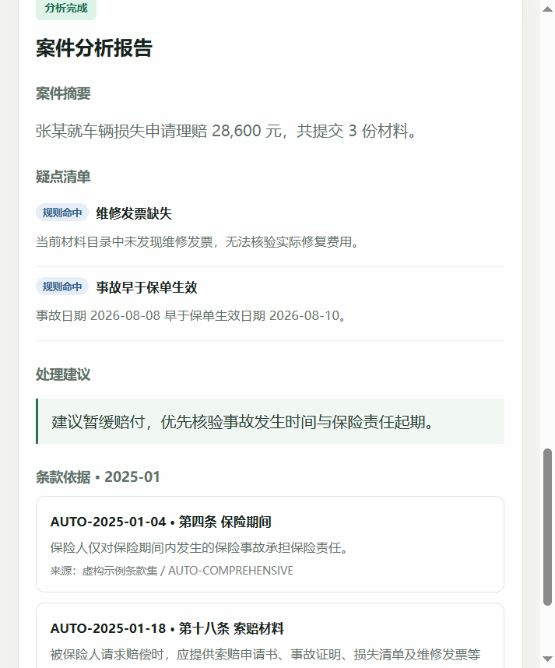
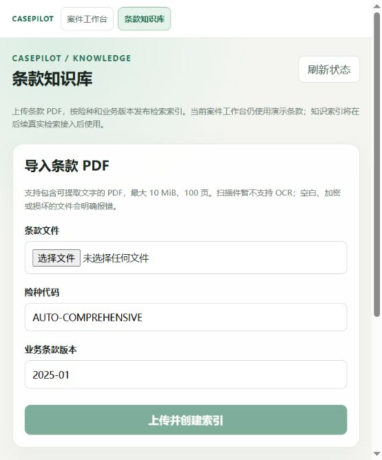

# 实施状态

更新日期：2026-10-23（北京时间）。当前服务端为 Python，案件分析仍为 V0，独立知识库推进至 G2。本文件合并迁移成果与知识库记录；历史测试结果明确标注，不代替本次重新执行的结果。

## 迁移成果与运行约束

- 服务端采用 Python 3.12、FastAPI、Pydantic、LangGraph Python、Psycopg 3、PostgreSQL/pgvector；Vue/TypeScript 前端保留，Node.js 只用于前端、测试与契约构建。
- 旧 NestJS、JS LangGraph、RxJS、pg 服务端及其脚本已移除，不维护两套 API。
- 两个虚构案件、三项确定性规则、关键词条款、模板报告、interrupt/Command 和 HTTP/SSE 均保留。创建/审核返回 201，accepted 表示命令接受，不代表执行完成。
- 内存模式重启丢失任务；PostgreSQL 模式持久化任务 JSONB 快照、事件、命令及官方 checkpoint。默认业务 schema 为 `casepilot_python`，checkpoint 为 `casepilot_python_checkpoint`，不读取或覆盖原 JS checkpoint。
- 创建任务与 start 命令同事务；审核决定与 resume 命令同事务。业务事务与 checkpoint 仍是独立提交边界，不能描述为全局原子事务。
- 正式入口为 `python -m casepilot`，Windows 使用兼容 Psycopg 异步驱动的 Selector runner；单 worker，并通过业务 schema 的 advisory lock 拒绝第二实例覆盖内存投影。
- Pydantic JSON Schema 生成 TypeScript 和 Ajv 校验，生成产物入库；模型探测不在启动、readiness 或常规测试中自动执行。
- 迁移阶段已修正 UTC 毫秒事件序列化、严格布尔校验及审核并发提交问题，相关测试保留。

## 当前门禁

| 阶段 | 实际状态 |
| --- | --- |
| Python 迁移 / G1 | 已完成 V0 闭环、基础 PostgreSQL 恢复与旧后端清理；运行约束见上节 |
| 真实模型前提 / G0 | 保留未通过：上次复测 HTTP 429 / 1305（模型繁忙）。本轮没有发送真实模型或 Embedding 请求 |
| G2 知识库 | 代码、确定性测试、真实 PDF / PostgreSQL / 进程故障测试通过；真实供应商 Embedding 与语义质量尚未验收 |
| G3 Agent | 首批服务端组件已开发：真实 Tools、有界图、聊天适配、事实/引用校验及持久调用账本；正式入口接入和真实模型验收未完成 |
| G4 多轮 / 增量 / 完整恢复 | 待开发：会话与不可变上下文、审核幂等协议、三节模型报告和完整崩溃窗口；复用 G3 调用账本 |
| G5 联合验收 | 未执行，不宣称完整 V1 已完成 |

## G2 交付

- `knowledge/pdf.py`：真实 LangChain PyPDFLoader 按页解析和 RecursiveCharacterTextSplitter，800 字符/120 重叠；保留真实 1-based 页码和全局块序号。文字型 PDF 限 10 MiB、100 页；损坏、加密、空白、扫描文件明确失败，不启用 OCR。
- `knowledge/repository.py`：版本迁移门禁（版本 1/2）、源文件 bytea、document / generation / chunk / publication / request；固定 `vector(1024)`、参数化精确余弦查询，险种、业务版本、generation 与 Embedding profile 硬隔离。
- `knowledge/service.py`：单 worker 处理 queued → parsing → chunking → embedding → ready / failed；批量校验向量，全部完成后事务内 CAS 发布；启动对账把中断的中间态标为 INDEXING_INTERRUPTED，queued 继续处理。
- `api/knowledge.py`：multipart 导入、列表、generation 查询和显式 retry。413/415/422/409/503 具有稳定 code/message/requestId；未知错误安全返回 500，不泄露异常原文。
- `model/embeddings.py`：生产批量 Embedding 适配器（最多 64 条/请求），按返回 index 对齐输入；严格校验数量、1024 维、非布尔有限 float32、非零向量；不自动重试或回退。错误只保存白名单业务码、状态、请求 ID 和 Retry-After，不保存任意供应商错误正文。
- 前端新增“条款知识库”：文件、险种/业务版本、替换确认、阶段计数、已就绪/当前发布区分、错误、retry、attempt 记录和历史版本；短轮询在切换、暂停、卸载时失效，旧回调不能覆盖当前选择。
- Pydantic V0/V1 模型统一导出到 `packages/contracts/schema/transport.json`，生成 TS 与 Ajv 校验。前端没有另抄一份知识库 DTO。

## 一致性与重复提交

同险种、业务版本的发布指针与 generation 就绪状态在一个事务内更新；数据库三元组 FK 防止 publication 指向其他险种或版本。构建中和失败时，旧发布仍可查询。旧 generation 和原文保留，查询固定旧代不会自动切到新代。

重复导入复用相同内容、元数据、处理配置及相同发布目标的 generation；当前 active 内容完全相同时，即使表单携带当前 expectedGenerationId，也直接复用，不重复向量化。

retry 使用 expectedRevision 和 Idempotency-Key，保留旧 attempt。重试不能偷偷把原出版期望改为最新指针；期间发生发布变化时返回 GENERATION_CONFLICT，用户需重新确认上传。明确选择新的出版目标会创建新 generation，而非重新发布旧代。

## G2 开发阶段的历史验证

以下结果来自整理前已有的开发记录，保留为对应阶段的证据；不是本次结构整理重新执行的结果。

| 验证 | 结果 | 证据边界 |
| --- | --- | --- |
| Python 全套 | 主代理运行 scripts/test.py --database -q：119 passed，91.07 秒，无 skip | 含既有迁移回归、实际 PDF、模型 MockTransport、实际 pgvector、正式 API 和独立进程故障测试 |
| PDF | 文字多页、跨页条款、空页保留、100/101 页、扫描图像、加密和损坏样本通过 | 自编 PDF；不证明 OCR 或任意第三方 PDF 排版提取质量 |
| 真实 PostgreSQL | 向量写入/余弦运算、版本隔离、处理中读旧版、第 2 批失败、并发 CAS、去重与幂等通过 | Embedding 来自注入替身，不作为实际供应商向量或语义评测证据 |
| 进程中断 | parsing / chunking / embedding 持久阶段分别强杀组件进程，随后启动正式 API 对账，通过 | 未模拟外部 Embedding HTTP 请求在途的所有模糊窗口 |
| schema 约束 | 迁移重复运行、未知版本拒绝、跨险种/版本 publication FK 通过 | 不修改 JS / V0 表，不删除项目数据卷 |
| HTTP | 正式 API 子进程验证 multipart、限额/格式、异步失败、空 Key 明确失败、retry 幂等 | 凭据显式置空；不发送真实供应商请求 |
| 前端 | 15 项通过：契约 5、原 reducer/作用域 6、知识库生命周期 4 | 真实 Vue mount/unmount 与迟到请求、retry 复用、409 后重新确认；不是完整浏览器成功导入验收 |
| 契约与构建 | generate:check、TypeScript 与 Vue/Vite 构建通过，277 modules | 生成文件与 Python 模型一致 |
| 静态检查 | Ruff check / format --check、git diff --check 通过 | API、工程脚本和 Python 测试 |
| 浏览器 | PostgreSQL 模式重启正式服务后，知识库导航、空列表、默认元数据、上传界面显示正常 | 没有使用假向量制造成功发布的页面证据 |

所有数据库测试仅创建、清理随机 UUID 测试 schema。开发 schema 中没有植入测试向量或伪造已发布索引。工作台原案件与报告在服务重启后保留。

以下为已有 Python 页面截图，保留作界面参考：

## 仓库目录整理阶段验证

2026-10-23 对目录、契约残留和中文文档整理后重新执行：

- API 完整回归：119 通过，无跳过，90.99 秒；实际数据库与进程恢复已执行，模型/Embedding 仍使用替身。
- 统一 `pnpm test`：后端常规 99 通过、20 项数据库测试默认跳过；契约 5 通过、前端 10 通过。
- 契约生成一致性、契约/前端构建、Ruff 检查与格式检查通过；Vite 当前构建 179 modules。
- 10 份文档、43 个本地链接检查通过；旧导入与旧测试路径已同步移除。

详细操作原因、删除依据和环境说明见 [整理记录](整理记录.md)。本次结构整理没有执行真实模型或新增浏览器功能验收，G0/G3/G4/G5 状态保持上表边界。

## 内部架构整理阶段验证

随后按职责拆分 API、分析应用服务、图/节点/状态、模型适配、持久化与传输模型，并移除业务层的 FastAPI 依赖。最终后端测试 123 通过、无跳过（78.03 秒），含新增 4 项架构边界和应用实例隔离测试；前端与契约 15 项、生成契约一致性、构建和 Ruff 检查均通过。

额外在重构前由旧实现创建真实 PostgreSQL 待审核任务，重构后由新实现读取原快照、恢复 checkpoint 并通过审核，确认原事件保留且只生成一次最终报告；测试 schema 已清理。详细原因、模块职责和特殊边界见 [内部架构检查与整理](内部架构检查与整理.md)。本阶段没有接入新的模型 Agent 功能。

## 后续工作与限制

最新 G3 组件回归为后端 167 通过、无跳过（83.53 秒），含新增 44 项；前端与契约 15 项、契约一致性、构建和 Ruff 通过。实际 PDF/pgvector 接入组件及调用账本跨进程强杀/重启已测，外部模型/Embedding 均为替身。现有工作台仍走 V0；不能据此将 G3 正式接入或真实模型质量标为通过。

G3 首批组件已经开发并可独立执行有界分析图；步骤、测试与剩余功能见 [智能分析阶段开发记录](智能分析阶段开发记录.md)。正式入口接入涉及 V1 协议和旧报告处理，见待确认的 [工作台切换方案](../设计/工作台切换方案.md)。随后继续 G4 的持久会话、审核新协议与三节真实生成。当前工作台仍为 V0 关键词库和模板报告，没有静默替换其行为。

真实供应商 Embedding、固定语义题集 Hit@4、报告引用语义支持和真实模型联合验收仍待执行。用户略过拥堵允许继续开发，不代表这些门禁通过。

本轮测试有一项第三方弃用提示：langchain-community 已被维护方[宣布 sunset](https://github.com/langchain-ai/langchain-community/issues/674)，本项目当前通过该包使用 PyPDFLoader。锁定版本用于本轮已验证的加载边界；后续替换解析集成时须保留页码、拒绝格式及 PDF 回归，不能靠过滤 warning 隐藏维护状态。
