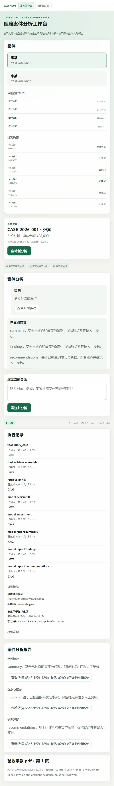

# 工作台接入开发记录

本页记录入口切换阶段。后续剩余功能与已授权真实验收的当前结果见 [2026-10-27 验收记录](../验收/2026-10-27验收记录.md)；下文“未执行真实调用”等描述仅指入口切换阶段。

日期：2026-10-26 至 2026-10-27。依据：用户确认“保留旧报告只读，新任务切换 V1”，随后要求继续实施。本轮没有扩大到新模型、删除历史数据、多 worker 或真实付费服务探测。

## 每一步的意图与原因

| 步骤 | 实际工作 | 意图与原因 |
| --- | --- | --- |
| 1. 固定切换边界 | 检查已有任务，保存旧报告状态及校验摘要 | 旧报告缺少 V1 的模型调用与证据字段，不能通过补造数据伪装为新任务；活动旧任务需先处理 |
| 2. 建立统一契约 | 新增 `schemas/agent.py`、`schemas/workspace.py`，导出请求、响应和判别联合事件，生成 TS/Ajv | 后端、页面、SSE 共用同一可执行定义，避免各自维护不一致的 DTO；旧模型仍支持历史读取 |
| 3. 增量持久化 | `WorkspaceRepository` 在原 tasks/commands 旁增加会话、消息、metadata、events、requests、reviews 和迁移版本表 | 保留现有数据与知识库，用事务及 FK/部分唯一索引保证所属会话和每会话一个活动任务 |
| 4. 固定会话上下文 | 预检依赖；记录案件快照/哈希、知识 generation、Embedding profile、模型和提示版本、实际 messageIds | 发布新条款或修改配置后，不能让同一会话的旧结论悄悄更换依据；预检失败不写半条消息 |
| 5. 接入有界 Agent | 工作台图调用既有真实 Tools 和分析图；账本同时投影实际执行事件 | 查询、规则、检索、补检和结构分析沿真实执行路径完成；卡片反映实际调用，不展示思考过程 |
| 6. 持久审核协议 | checkpoint 确认暂停后才发布审核点；审核带幂等键、interruptKey 和 expectedRevision | 避免旧页面、双击或并发通过/驳回重复恢复；202 表示决定被接受，不表示报告完成 |
| 7. 三节分别生成 | 独立生成摘要、疑点与依据、处理建议；每节校验 JSON 和事实/引用白名单后持久化 | 让用户尽早看到经过校验的进度；不把部分正文标成正式报告，全部完成才写最终助手消息 |
| 8. 故障恢复 | 复用已完成调用与章节；超时和模糊调用保留原预算，要求显式 recover | 数据库/checkpoint/外部请求无法全局原子提交；不确定窗口不能免费自动重放或清零额度 |
| 9. 升级页面 | 会话导航、消息追问、审核、恢复、执行卡片、章节和任务引用面板；选择作用域保护 HTTP/SSE/catch/finally | 用户切换案件或会话后，迟到结果不能覆盖当前页面；流中断先取新快照，冲突以服务器状态为准 |
| 10. 迁移验收测试 | 将旧版 TCP/强杀进程验收改为 V1，补充真实数据库和 Vue 生命周期测试 | 接口升级不能靠删除旧断言或跳过测试获得通过；继续验证暂停时能收到 SSE 和重启后的审核点 |
| 11. 移除旧执行实现 | 删除旧服务/执行器/模板报告、旧图节点/状态、关键词库及无调用方的页面组件 | 正式入口只有一套可写流程，减少误接旧模板与维护歧义；旧报告的 DTO 和 ReportPanel 继续保留 |
| 12. 校验原开发库 | 执行增量迁移，比较迁移前后的全部既有任务 JSONB | 实际验证数据保留承诺；结果为迁移版本 1、3 份旧报告、所有原快照完全一致 |

## 模块组织

`workflow/workspace_graph.py` 只定义外层拓扑，`workspace_nodes.py` 管理分析、纯审核中断和章节节点；内层 `agent_graph/agent_nodes/agent_state` 处理有界分析。

`analyses/workspace_service.py` 负责用例与依赖预检，`workspace_store.py` 负责任务投影和原子业务更新，`workspace_executor.py` 消费持久命令并对账；`sections.py` 负责章节模型输出，`ledger.py` 负责跨恢复预算。SQL 留在 `persistence/workspace_repository.py`。HTTP/SSE 仅负责传输和错误映射。

保留基础 Store 和原 tasks/commands 仓储供历史读取及独立 Agent 组件测试使用；生产组合根使用 WorkspaceStore/WorkspaceService/WorkspaceExecutor。旧 V0 AnalysisService、Executor、图、关键词检索与模板报告均已删除，不再有旧版 HTTP 创建路径。

## 已执行验证及边界

- 后端最终全量数据库：172 项通过，无跳过（109.26 秒）；Ruff 检查与格式检查、契约一致性、Vue/Vite 构建及 git diff --check 通过。新增存储故障返回 503 的脱敏测试，并确认故障已保存后再次消费旧命令不会重复调用模型或改写错误。
- 新增工作台数据库测试覆盖完整三节、追问独立任务与固定上下文、幂等优先级、并发审核、部分报告可见、章节失败恢复及预算不归零、旧报告拒绝写入、依赖预检不留孤立数据、失败回合不进入上下文、引用任务范围与游标规则。
- TCP 测试验证暂停状态的 SSE 实时到达、Header 游标优先、重放尾部和终态结束；独立 API 进程强杀后恢复原审核点，并发决定仅接受一个，第三次启动快照仍一致。
- 前端／契约 21 项通过，构建通过。真实 Vue mount/unmount 测试覆盖旧请求和 SSE 回调隔离、未知响应重试复用问题及幂等键、已完成后相同问题使用新键、409 后重取快照、断流及刷新后从服务器快照恢复。
- 浏览器使用真实 Vue/Vite、FastAPI、PostgreSQL 与 pgvector；模型和 Embedding 是测试入口显式注入的替身，数据库为 UUID 隔离 schema。验证会话创建、审核通过、三节报告、引用文件/页码/原文、案件切换与已有会话读取。
- 实际开发 schema `casepilot_python` 的增量迁移已执行，迁移前保存的 3 份 completed 报告校验摘要匹配；迁移前后所有已有任务 JSONB 文本逐条完全一致。没有删除原表、checkpoint、knowledge 数据或数据卷。

## 还需要完成的验收

真实供应商能力、语义题集 Hit@4、引用原文是否支持结论、无依据策略及提示注入评估，仍需按 [验收方案](../设计/验收方案.md) 执行。还需扩大供应商在途请求和 checkpoint/业务交错提交的故障矩阵，以及长会话分页的联合验收。现有强杀和超时测试覆盖其具体窗口，不声称覆盖所有故障。

本轮没有自动恢复之前略过的真实模型探测，也没有执行付费模型或 Embedding 请求。生产代码调用真实适配器；测试证明流程和一致性，不能代替模型质量门禁。当前总状态见 [实施状态](实施状态.md)。

当前引用原文块及页码已经可用，设计中的相邻块查询与展示仍待补齐。浏览器预览使用独立 UUID 测试 schema 和测试适配器，暂时保留供继续人工检查；其固定回答不是实际模型输出，也不进入开发业务 schema。

以下截图仅记录测试适配器下的多轮、报告和引用界面，不代表模型质量验收：

