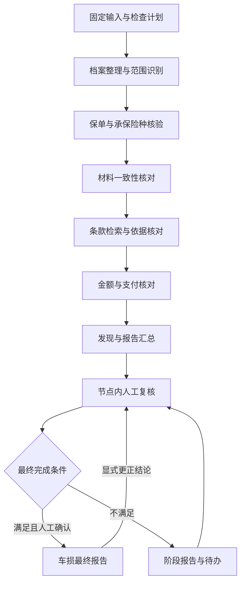

# 审查执行与复核报告开发设计

日期：2026-10-29  
状态：开发设计；流程冲突项已由用户确认，本文不代表功能已交付。  
覆盖范围：需求 6.4—6.8，以及支撑这些功能的第 7 节状态与最终完成条件。

## 1. 依据、优先级与交付边界

### 1.1 设计依据

仅使用以下三份文档作为需求及既有设计依据，其他历史文档不作为本设计的依据：

1. [已结案车险赔案审查 agent 需求](../需求/已结案车险赔案审查agent需求.md)：6.4—6.8 为本次主体，第 2、3、4、6.3、7 节用于界定对象、身份、固定输入及完成条件。
2. [案件查询与详情页设计](案件查询与详情页设计.md)：复用案件、车辆、保单、险种、金额口径和证据定位关系。
3. [启动审查与输入固定设计](启动审查与输入固定设计.md)：复用预检、固定快照、知识绑定、幂等、显式重审及补充证据机制。

三份文档中的阶段完成状态和“本阶段不做”用于解释其当时边界，不作为当前代码能力的证明，也不阻止本次明确提出的后续功能。现状以本次读取的代码为准。

### 1.2 用户已明确的页面及报告要求

以下直接要求优先于上述文档中不同的页面安排：

- 点击左侧案件卡片进入统一工作台，案件摘要与审查流程合并。主区域保留“当前案件”“启动前检查”“执行记录”。
- 启动前检查紧凑展示；完整案件资料按需查看，不再增加一块重复的“案件分析”内容。
- 问题、证据、人工复核及处理历史放在实际所属节点。报告生成、保存和人工确认记录也进入对应节点的时间轴。
- 案件分析报告放在当前案件卡片中，点击按钮弹窗查看；节点保留相应版本的入口。
- 节点长文本超过五行折叠，允许展开；证据入口、当前状态和操作按钮保持可见。
- 历史分析任务放在当前案件卡片中，只列当前案件任务，不放在左侧菜单栏。
- 报告执行规范表达，按实际情况输出必要内容，不要求所有案件使用固定章节和固定篇幅。

需求 6.8 的九类信息作为底层可追溯信息要求，而非九个必填的可见章节。无问题案件可以简短；实际存在的检查失败、范围限制、未决事项和人工结论不得因精简而遗漏。

### 1.3 本次交付目标

形成可验证的完整链路：真实执行 → 检查结果 → 审查发现 → 原始证据 → 人工复核 → 完成条件校验 → 固定版本报告。

本设计不建设原理赔处理、支付纠正、自动外发转交、OCR、通用规则配置平台或复杂组织审批。保留现有框架和知识库基础设施，不为本次功能升级依赖。

## 2. 现有实现与差距

以下为代码核对结果，不等同于本次设计已实施。

| 能力 | 当前实现 | 本次补齐 |
| --- | --- | --- |
| 六个业务节点 | `reviewExecution.ts` 将工具调用、检查和事件归组，前端推算状态 | 后端持久化业务节点及其尝试，前端直接读取权威状态 |
| 真实执行记录 | `TaskLedger` 在调用前保存意图，保存实际调用结果并投影事件 | 调用显式绑定节点、检查项和输入依据，不再靠名称推测所属节点 |
| 节点状态 | `ExecutionData` 只有 running/completed/failed；页面混入待人工复核 | 六种执行状态齐备，人工处理状态单独管理 |
| 工作流 | 外层 analyze → human_review → report → complete；内层有局部规则检查、检索和集中模型分析 | 保留任务生命周期，将实际检查划归六个业务阶段并逐步提交结果 |
| 中途成果 | 调用结果已保存；公开的事实、发现和检查主要在 `analysis_ready()` 整体提交 | 每个检查完成后即可保存和查看，失败仍保留已提交成果 |
| 业务检查 | 有范围、保险期间、部分承保关系、算式、汇总、核赔与实付核对 | 补齐材料字段冲突、批单影响、条款实质支持、支付分配及重复线索 |
| 检查与发现 | `ReviewCheck` 同时承担通过项、疑点、受限项和范围外提示 | 明确检查执行、检查结果和需人工处理的发现，避免相互代替 |
| 人工复核 | 有四种动作、身份、引用、变更原因、幂等和 revision 校验 | 补齐人工新增发现、实际人工补做检查、专业意见、后续办理及证据查看记录 |
| 受限项解决 | `unresolved_checks()` 使用“排除 + 补充依据”等条件判断解决 | 分别校验疑点结论和检查覆盖；上传附件或排除疑点本身不代表补做了检查 |
| 最终确认 | 已要求人工确认覆盖和意见，限制未决检查 | 增加必要检查、节点状态、有效范围、专业复核和报告依据一致性校验 |
| 报告 | 有待复核/阶段/最终三种和版本列表；复核保存时生成阶段版本 | 固定完整结构化依据和分类统计，支持完成后的更正与办理状态修订 |
| 完成后操作 | `completed` 为终态，复核仅允许 waiting_review | 经显式操作重新进入人工修订；保留旧报告，不自动重跑 AI |
| 并发与存储 | 复用 PostgreSQL、任务 JSONB、命令、事件及幂等请求表 | 在数据库事务内增加严格的预期版本比较，不能只依赖进程内锁 |

重点代码位置：

- 后端契约：`apps/api/src/casepilot/schemas/agent.py`、`schemas/workspace.py`。
- 执行与恢复：`workflow/agent_graph.py`、`agent_nodes.py`、`workspace_graph.py`、`workspace_nodes.py`，以及 `analyses/ledger.py`、`workspace_executor.py`。
- 检查、复核及报告：`analyses/checks.py`、`evidence.py`、`reports.py`、`workspace_store.py`。
- 持久化与接口：`persistence/workspace_repository.py`、`api/analyses.py`。
- 页面：`WorkbenchPage.vue`、`FindingReviewCard.vue`、`ReviewReportDialog.vue`、`domain/reviewExecution.ts`。

## 3. 与现有流程冲突的确认结果

以下三项已于本次对话中逐项向用户确认，并采用用户选择，不再保留未决方案。

| 编号 | 现有流程及冲突 | 用户确认的处理方式 | 实施约束 |
| --- | --- | --- | --- |
| D01 | 原输入范围固定，当前没有范围调整入口；必要检查不能完成时无法继续最终确认 | 允许人工缩小本次有效范围后生成限定范围最终报告 | 单独追加范围调整记录，保留原输入、失败原因、人员、时间和影响；报告明确限定后的对象和项目 |
| D02 | 当前受限项主要靠关联依据后“排除”，没有人工实际补做检查记录 | 允许在原任务人工补做检查，保留原 AI 结果和执行状态 | 必须记录步骤、输入、依据、结果和人员；AI 使用新材料仍须显式创建新任务 |
| D03 | 当前最终报告生成后任务锁定，不能继续更正或更新办理状态 | 允许同一任务追加修订及报告版本；实质性结论变更重新复核确认 | 旧报告不可覆盖；结论变化显式重新打开人工复核；仅办理状态变化也形成新的报告版本并注明修订原因 |

这三项仅改变人工审查的可追加能力，不改变固定输入与 AI 重审原则。未涉及上述选择的缺失功能按本次需求补齐，不另建并行任务系统。

## 4. 总体流程与状态职责

### 4.1 复用现有主链路

继续使用 `Conversation → Analysis → Command → Event/SSE → Review → Report`。六个业务节点是同一 Analysis 内的执行单元，不是六个独立任务，也不要求六次模型调用。



图示为默认业务顺序。局部资料不足或节点失败时，保存结果，并继续执行不依赖该结果的检查；不能因为一份计算书缺失跳过整个案件。只有输入关系无法安全使用、存储故障等影响全局可靠性的情况才停止整轮调度。

检查计划明确依赖，而不是让模型自由决定是否跳过必要检查。先完成简单顺序调度，不引入通用并行 DAG 引擎。允许金额工具提前准备确定性数据，但条款适用尚未明确时，不提前给出依赖条款的赔付正确性结论。 三个模型审查阶段各最多执行一次结构修正，仍受整案最多 8 次模型调用的总预算约束；修正后继续校验来源与原文，预算耗尽保留部分结果。

### 4.2 三类状态分别表达

| 类别 | 设计 | 权威来源 |
| --- | --- | --- |
| 原赔案状态 | 原结案类型、核赔、支付状态分别保留 | 固定案件快照；本系统不修改 |
| 自动执行状态 | 未启动、执行中、已结束、失败、待恢复 | 后端从节点执行、调度及命令状态投影 |
| 人工审查状态 | 待人工复核、复核中、待核实、车损审查完成 | 后端从有效范围、检查覆盖、最新人工记录及最终确认投影 |

保留现有 `AnalysisStatus` 作为命令调度状态，不让它同时代替上述所有业务含义。增加明确的 `automationStatus`、`reviewStatus` 和 `finalizationEligibility` 只读投影，均由服务端按同一规则产生，前端不维护另一套完成判断。

自动执行已停止且没有在途命令时，允许复核已保存的稳定结果，包括局部失败或待恢复任务中的结果。恢复与人工写入互斥校验；恢复过程中不接受基于旧版本的复核。该安排用于落实 D02，不将失败节点冒充正常完成。

部分失败任务也建立可识别的人工复核轮次和审核点。人工补做或范围调整满足最终条件后，显式最终确认可转入 resuming 完成报告保存，自动执行失败/待恢复事实仍保留。执行器按命令类型及完成校验判断可否执行，不能继续以“failed/recoverable 一律跳过命令”阻断已获准的人工流程，也不能把人工确认路由到技术恢复或 analyze。

人工复核在对应节点展开，不要求每个节点都弹出审核并阻塞下一节点。无疑点的正常案仍需最后的人工覆盖确认。

## 5. 领域模型与契约

### 5.1 模型边界

| 对象 | 主要职责及字段 |
| --- | --- |
| `CheckPlanItem` | 稳定 `checkId`、`checkCode`、规则版本、`nodeKey`、`scopeItemId`、赔案/对象/保单/险种 ID、是否必要、适用性、依赖和需要的输入；计划与事实无关的缺省判断不得伪装已执行 |
| `NodeRun` | `nodeRunId`、节点、当前尝试、六态执行状态、起止时间、耗时、摘要、原因、检查 ID；保留历次尝试 |
| `CheckRun` | 某检查的一次实际执行：尝试号、执行人类型、调用记录、输入摘要 hash、执行状态、检查结果版本、起止时间和失败原因 |
| `CheckResult` | 已核实的计算或判断；结果为 clear/concern/limited/no_conclusion，包含证据、公式、原始值和判断限制；不适用另由适用性表达 |
| `Finding` | 需要人员处理的业务疑点、检查限制或范围外事项，独立稳定 ID、归属检查和主节点、范围、来源声明、原值、证据、依据、不确定性和建议 |
| `FindingReview` | 逐条人工决定，追加保存；关联发现版本、证据、意见、动作必填字段、操作人及前一决定 |
| `EvidenceRef` | 统一定位案件结构化记录、材料原文、条款、补充 PDF 或带来源的业务记录；固定来源版本/hash |
| `HumanCheckCompletion` | D02 的人工检查履行记录，关联原检查、步骤、输入、结果、计算或专业判断来源及证据，不改写自动执行状态 |
| `ScopeAdjustment` | D01 的范围调整：从原范围排除哪些对象/检查、原因、影响、证据、操作者及版本 |
| `ProfessionalReview` | 接收人/岗位、转交原因、已提供材料、跟进状态、授权人员录入的专业意见、意见来源及最终处理记录 |
| `FollowupRecord` | 建议动作、责任对象、处理去向及办理状态，与问题是否确认分开 |
| `ReportSnapshot` | 固定报告类型、版本、业务依据、分类统计、人员、生成信息和按需展示内容 |

这些对象仍属于现有 Analysis 聚合，保存到任务 JSONB 并以事件留痕。首期不为每个对象新增独立资源表，也不建立另一套 review_analysis/review_event/review_report 系统。

### 5.2 检查、结果和发现分开

- 一项检查执行完成，可以得到“未见异常”或“发现疑点”；存在疑点不等于程序执行失败。
- 必要输入缺失时，记录检查无法完成及限制，不能生成 clear，也不能把检查从计划里删掉。
- clear 作为检查覆盖记录，不生成待复核疑点。concern 形成业务疑点；limited 形成限制事项；范围外线索形成范围外事项。
- 每条实际发现首次状态都是 `pending_review`，不因为规则计算确定或 AI 使用肯定语气就自动变成“确认问题”。
- 同一检查可形成多条不同发现，也可由多个来源支持同一发现。规则判断、模型推断、原核赔意见及人工决定分别存储和标注。
- 受限事项可以被确认成“存在作业记录缺陷”，但这不代表缺失的必要计算已补做。发现处理完成和必要检查完成分别校验。

### 5.3 稳定标识与去重

- `checkId` 由任务、检查代码和业务对象组合稳定生成；`findingId` 由任务、检查、对象及规范化问题代码确定，不依赖可变化的模型标题。
- AI 在允许的检查及对象范围内提交结构化问题代码；服务端校验后生成 ID。无法确定属于同一事实的问题保留独立记录，允许人工显式关联并留原因。
- 同一问题的规则与 AI 声明归入同一个 Finding，保留各自说明和证据。不同问题、不同金额口径、相反判断不因文字相似自动合并。
- 恢复时复用已提交的稳定 ID；同一来源的结果变更追加结果版本，不覆盖原说明。重复 SSE 事件不新增发现。
- 人工新增发现明确 `source=human`。与已有发现可能重复时提示查看或关联，不能静默吞掉人工记录或改成 AI 命中。

### 5.4 原始值与证据引用

`EvidenceRef` 使用受控的来源类别和对应字段：

| 类别 | 必须保留的定位信息 |
| --- | --- |
| 案件结构化记录 | 原输入版本、集合/业务 ID、JSON Pointer、来源说明、原值 |
| 原始材料 | 文档 ID、版本、SHA-256、真实页码或原文位置、引用摘录 |
| 条款 | 固定 generation、文档 ID/hash、产品/版本、chunk/页码、原文及允许的适用范围 |
| 补充 PDF | supplement ID、版本、SHA-256、页码、提交人和时间 |
| 人工提供的业务记录 | 来源系统/记录号、取得时间、提供人、内容版本和引用位置；缺少来源不得作为已证实记录 |

字段观察值保存 rawValue、可选 normalizedValue、值状态和证据引用；多个来源各存一行。值状态区分 present/missing/invalid，来源冲突另记录 conflict，不能挑一个值覆盖其他值。

引用由服务端解析并校验归属。无真实 PDF 定位时展示结构化记录或来源不足，不补造页码；响应不暴露本机路径。报告及历史查看使用固定版本，不读取当前案件资料替换历史依据。

### 5.5 关键契约示例

以下省略与示例无关的聚合字段；ID 和 hash 为占位符，不是演示运行结果。

```json
{
  "nodeRunId": "<本次自动执行的金额节点 ID>",
  "nodeKey": "amount",
  "attempt": 1,
  "status": "unable",
  "startedAt": "2026-10-29T02:00:00.000Z",
  "endedAt": "2026-10-29T02:00:01.200Z",
  "durationMs": 1200,
  "summary": "2 项检查完成，1 项必要检查因缺少计算书无法完成",
  "reasonCode": "REQUIRED_MATERIAL_NOT_OBTAINED",
  "checkIds": ["<计算复核检查 ID>", "<支付对应检查 ID>", "<重复线索检查 ID>"]
}
```

节点状态之外的覆盖投影单独返回，例如 `coverage.method=human`、`coverage.completionId`、`coverage.satisfied=true`；不能为表示人工补做而改写上述 status。

最终确认请求设计：

```json
{
  "decision": "approve",
  "reviewCycleId": "<当前人工复核轮次>",
  "interruptKey": "<当前轮次的审核点>",
  "expectedRevision": 42,
  "reportVersion": 3,
  "basisHash": "<服务端返回的完整 SHA-256>",
  "coverageConfirmed": true,
  "comment": "已查看本次限定范围、必要检查履行、逐条人工结论及报告内容。"
}
```

接口只接受服务端已有的当前审核点、版本和 hash，不能让客户端提供一份任意报告内容充当已确认依据。完整字段约束、枚举和引用校验由后端 DTO 统一定义，示例不替代 schema。

## 6. 业务节点执行与失败处理

### 6.1 六种执行状态

后端统一使用 `not_started`、`running`、`completed`、`failed`、`unable`、`not_applicable`。

| 状态 | 进入条件 | 展示要求 |
| --- | --- | --- |
| 未开始 | 已列入计划，尚无实际执行；或等待前置条件 | 展示待执行检查和等待原因 |
| 执行中 | 开始事件及调用意图已提交，实际检查进行中 | 展示当前检查和开始时间 |
| 已完成 | 本节点适用的计划检查已实际完成，结果均已提交 | 展示结果摘要；可以含待复核疑点 |
| 执行失败 | 工具、模型、存储结果校验等发生技术执行错误 | 展示安全错误码、失败步骤、已保存结果和恢复方式 |
| 无法执行 | 资料、必要事实、条款或依赖不足，不能完成该检查 | 展示受影响检查、缺少条件和可继续项目 |
| 不适用 | 本次范围内不存在适用对象或满足明确的不适用条件 | 展示依据和理由，不计为通过 |

节点是检查状态的后端汇总：存在在途执行时为 running；结束后依次反映 failed、unable；全部有理由不适用时为 not_applicable；全部适用检查完成时才为 completed。混合完成和无法执行时为 unable，并保留已完成检查数量。未启动或因停止调度尚未执行的检查保持 not_started 并注明原因。

节点状态反映自动执行事实。人工补做或调整范围不会把原 failed/unable 改成 completed；另展示“人工已补做”“经范围调整不再要求”等有效覆盖情况。最终完成校验使用第 11 节的覆盖履行规则。

### 6.2 事件与耗时

- 节点开始、每次检查及工具调用、结果提交、节点结束均产生真实事件。SSE 心跳仅保活，不能改变业务进度。
- `nodeRunId`、`checkId`、`attempt`、`callId` 显式关联，不再通过调用名称前缀推断节点。
- 时间采用 UTC 保存、页面本地化展示。每次尝试保存开始/结束时间、实际运行耗时；暂停待人工和等待恢复的时间不计为执行耗时。
- 节点摘要来自实际结果计数和关键事实，例如“核对 3 个险种，2 项完成、1 项受限”。原因使用结构化 reasonCode 加可读说明，不仅写“已执行”。
- 一次尝试结束后耗时固定。恢复追加新尝试，保留旧尝试；并发子调用的耗时不直接相加冒充节点历时。

### 6.3 持久化、部分结果与显式恢复

每个可提交的检查结果采用一次事务保存：结果版本、相应发现、节点投影、事件、revision 和幂等效果标识。SSE 只发送已提交事件。

保留“调用前记录意图 → 实际调用 → 保存结果”的 ledger。调用结果已保存但节点结果尚未提交时，恢复可重用结果并幂等提交；不能为补页面记录再次发起同一模型调用。

失败处理规则：

1. 保留所有已提交事实、检查、发现、人工记录和报告版本；不再以清空 report 指针表示失败。
2. 隔离失败的检查，允许不受影响的检查继续。依赖失败结果的检查记录无法执行或尚未执行及明确原因。
3. 用已保存结果形成阶段性执行说明；报告明确自动执行中断及未覆盖范围。不得根据空疑点列表生成“未发现疑点”的成功结论。
4. 重试/恢复必须由人员显式命令触发，记录操作者、原因、版本和尝试号。服务启动或页面刷新不自动重放结果未知的外部调用。
5. 恢复使用原快照、原知识绑定和运行配置，跳过已完成且输入一致的检查。恢复不得夹带新材料或切换当前知识版本。
6. 调用超时且外部结果未知时明确提示不确定性；显式恢复可能产生新的模型计费，不能承诺外部调用严格只发生一次。
7. 新材料参与 AI、新知识版本、新范围下需要重新分析或已完成分析需要重算时，使用显式新任务和 predecessorAnalysisId，不在原 checkpoint 热插入资料。

结构化输出纠错作为原调用预算内的受限校验步骤保留，记录实际尝试。它不承担基础设施失败后的无限自动重试。检查计划、模型和检索预算在执行前固定，不能通过增加节点突破现有预算限制。

恢复重入时，仍由现有 analyze 调度读取已保存计划和节点/检查结果，按依赖逐项跳过有效的完成项、复用 ledger 结果、执行获准的新尝试，最后重新汇总公开结果。不新建平行 checkpoint 存储；外层 LangGraph checkpoint 与现有 ledger 继续承担流程检查点和调用结果保留。

初始检查计划按固定输入和检查目录生成。原文提取后需要细化对象或新增实际检查时，追加计划修订事件并说明来源；已列明的必要检查不得因后续模型没有返回而被删除。检查计划不接受 expected 答案作为输入。

## 7. 六个节点的实际检查设计

### 7.1 档案整理与范围识别

输入：固定事故、目标及关联赔案、人员、车辆、损失、材料目录和可读取原文。

工作：

- 建立赔案—车辆/人员—损失—保单/险种—计算/核赔/支付—材料的业务关联。保留目标/关联、本车/第三方、身份不明等属性。
- 原档案声明与材料线索分开识别。针对伤者、诊疗、医疗费用等线索提取对象及来源，形成“未发现人伤线索、有人伤、信息不足、信息冲突”四态。
- 未读取或缺失材料不能作为无人伤依据；原档案“未报人伤”仅是一个来源声明。
- 范围外事项单独建项；若人伤材料中的事故时间、责任等与车损共用事实冲突，同时建立受影响车损检查的阻塞关系。
- 非首期专业范围如全损、盗抢等明确标为限制，不自动套用部分损失检查结论。

输出：事实观察值、对象关系、材料取得及读取状态、人伤线索、范围外事项、受影响检查。

### 7.2 保单与承保险种核验

逐目标赔案和损失项目核对保单、车辆、险种、事故时间及保险期间；交强险、商业车损、商业三者分别关联，不能把合计金额归入一个险种。

区分未投保、保单未取得、无法识别、取得且承保。识别适用批单、特别约定及生效时间，保存其影响对象和原文。影响无法判断时输出待人工或专业确认；不能忽略批单后宣称承保核验通过。

输出：每项损失的适用关系、适用条款检索约束、可确定结论及尚缺信息。原核赔批准作为待核对的原意见展示，不是系统通过依据。

### 7.3 材料一致性核对

为事故时间、车辆标识、人员及角色、责任、损失归属和关键金额建立明确检查项。确定性格式与标准化规则先执行，AI 用于原文信息提取及语义关系判断。

- 缺失、格式错误和冲突分开；展示各来源原值、标准化方式及真实位置。
- 日期格式不同但值相同、车牌空格等可说明的规范化差异不直接判疑点。
- 损失归属必须结合对象和赔案关系，不因材料同时提及多辆车判混用。
- 依据具体索赔项目判断所需证据。第三方损失不适用时，不要求对应材料；同一有效材料允许支持多个关联检查。
- “本次档案未取得”是输入限制；“确认原作业未收集”须有相应业务证据和人工认定，不能由前者直接推导。

输出：字段对照、确认一致的项目、冲突和限制、受影响的后续检查，保留所有冲突原值供复核。

### 7.4 条款检索与依据核对

检索严格使用任务固定的文档/hash/generation、产品、险种和适用版本，并结合保单、损失类型及相关批单约束。检索返回为空是可见的依据不足，不是已完成合同判断。

引用分三层校验：

1. **来源存在**：实际返回的文档、chunk、页码、原文可定位，禁止模型补造元数据。
2. **适用范围正确**：文档/hash/generation 与固定绑定一致，条款所涉及产品、险种、对象及版本适用于该判断；原保单与批单不能跨案件使用。
3. **原文支持表述**：每条条款判断保存主张、支持摘录、适用条件、事实对应和未明确条件。摘录必须能在原文中定位；仅有合法 citationId 不代表支持成立。

自动化可验证前两层及摘录真实性，但语义支持不能仅靠 ID 或字串验证。AI 提供结构化的适用条件对照；未能说明支持关系、关键条件未满足或原文不足时标记 limited/uncertain，交人工核对。真实语义效果由标注样例单独验收，不把模型自评作为正确答案。

无足够依据时记录未取得、未检索到或不支持的具体原因，不补造条款，不给肯定责任结论。材料原文中的指令不改变范围、工具或系统行为。

### 7.5 金额与支付核对

金额内部使用整数分和明确币种；未知、不适用、已知零元分别表达。申请、定损、确认、理算、核赔、支付各自保留，跨口径比较必须说明目的。

| 检查 | 实施规则 |
| --- | --- |
| 明确算式 | 使用白名单确定性运算，保存公式版本、输入值/单位、来源、计算结果、原记录及差额；不执行模型或文件提供的任意表达式 |
| 复杂理算 | 适用规则、责任、合同参数和必要事实齐备才计算；规则未实现或条件不足时记录无法复核，不由模型估算替代 |
| 调整说明 | 对差额继续查询相应调整原因、签署记录及证据；解释成立时保留解释和来源，不自动认定差错 |
| 支付对应 | 按审批版本/生效状态关联有效支付和分配，保留分笔支付、收款对象和授权信息；审批总额与付款总额相同不代表明细关系必然正确 |
| 退款与冲销 | 按交易类型、状态及明确的原交易关联计算；原付款已被冲销时不得又重复减去同一冲销金额；未关联或状态不清时保留限制 |
| 重复线索 | 按同一损失、赔付对象、审批/支付关联及有效状态识别候选重复；出现多次或金额相同仅形成线索，不直接确认重复赔付 |
| 维修专业判断 | 缺少价格或专业核损依据时不认定价格过高、更换不合理，必要时提出专业复核事项 |

有效实付及审批汇总应共享现有案件投影中的金额口径，完善同一计算函数及其测试，避免页面、检查和报告各算一遍。无法确定关系时返回 unknown/limited，不能猜算。

### 7.6 发现与报告汇总

汇总实际检查、未完成项、发现及证据关系，完成去重和分类统计；不在最后一个汇总模型调用中悄悄完成未记录的前置检查。

初次自动分析结束形成待复核报告；部分失败或资料受限形成明确的阶段结果。报告保存事件归属本节点，问题本身仍归属发现它的检查节点。汇总不额外生成没有事实支持的“综合风险”。

## 8. 疑点与证据交互

### 8.1 每条发现的最低信息

编号、标题、所属节点/检查、来源及各来源声明、涉及赔案和车辆/人员/损失对象、关联保单及险种、发现说明、原始值、材料证据、适用条款或计算依据、不确定性、建议核实动作、当前人工处理状态及历次记录。

不适用的字段明确表示不适用或未确定及原因，不为凑字段编造保单、险种或条款。

### 8.2 筛选和数量

在“执行记录”内提供状态、来源、对象筛选和“只看未处理”。筛选后仍按原节点展示，不新增另一个主页面或侧栏疑点入口。

统一统计服务根据唯一 Finding 及其最新决定生成：待复核、确认问题、排除疑点、待核实、转专业未完成；业务疑点、检查限制和范围外事项分别分组。报告使用同一统计函数，但按其固定依据版本计算。不能拿当前统计更新旧报告。

范围外的人伤事项单列，不计入车损确认问题或车损未决数量；其影响车损共用事实的事项计入对应车损限制并阻止完成。

### 8.3 同屏查看与证据查看记录

点击发现后，在所属节点展开详情：左侧/上部为问题、原值、依据和来源，右侧/下部为人工表单和历史。适配窄屏顺序排列。

保留浏览器原生 PDF 打开能力，同时在发现详情内展示真实页码及支持摘录；条款及结构化记录在当前界面展示原文。无需为同屏复核建设完整 PDF 编辑器。

确认或排除前必须至少打开所关联的实质证据，并勾选“已查看所选依据”。服务端保存与操作者、任务、来源版本绑定的查看记录，提交时核验引用版本及查看记录；该记录证明系统提供和打开了依据，不宣称证明人员已充分阅读。找不到对应查看记录时提示先查看，不能只选一个 ID 就通过。

不存在整案一键确认全部发现。最终覆盖确认仅确认已满足条件的检查与报告，不批量改变逐条发现结论。

## 9. 人工复核、专业复核及后续办理

### 9.1 四种逐条动作

| 动作 | 除共同字段外的必填内容 | 处理状态 |
| --- | --- | --- |
| 确认问题 | 事实、判断理由、关联已查看证据、建议后续动作 | confirmed；仅确认问题，不代表整改完成 |
| 排除疑点 | 排除原因、合理解释或原推断不成立的依据、关联已查看证据 | excluded |
| 待补充核实 | 缺少内容、待核实问题、跟进对象/岗位 | pending_verification，仍未决 |
| 转专业复核 | 转交原因、接收人员/岗位、已提供材料及跟进安排 | referred，仍未决 |

共同记录 reviewId、findingId/发现版本、操作者、服务端时间、意见、证据、前一记录、任务版本。单填“同意”“无问题”不足；字数校验仅为辅助，表单必须结构化收集动作需要的信息。

变更已有决定必须填写原因，追加新记录并关联 previousReviewId。旧意见、证据和对应报告不修改；发现内容若发生实质修订，旧决定不自动套用到新版本。

### 9.2 人工新增发现

在每个业务节点提供“补充发现”，填写对象、问题、原始证据、依据和建议；服务端校验该节点及对象属于任务，标记人工来源并建立稳定发现记录。

新增项初始待复核。录入人可按相同规则另行保存确认/排除决定，保留两个动作，不伪造 AI 命中、不把“新增”自动当成“已确认”。完成后新增会改变最终结论的发现时，先按 D03 显式重新打开复核。

### 9.3 人工补做检查

根据 D02，在原 failed/unable/limited 检查旁提供“记录人工补做”。必填检查对象、补齐资料、逐步核对方法、输入值、公式/依据、实际结果、仍存限制和已查看证据。

服务端只在必要事实和依据齐备、记录通过校验时生成有效 `HumanCheckCompletion`。可计算项目使用同一确定性计算工具核算；不能仅凭人工填写“已完成”覆盖缺失计算。依赖专业判断的检查要求有可追溯的专业意见。

自动执行历史保持原状态。有效覆盖来源标记为 human，并展示谁完成了什么；问题确认/排除依然单独记录。补做结果不充分时保留未决，不解除完成限制。

人工补做不触发模型。需要 AI 使用新资料时，通过已有显式重审入口创建新任务，并固定新的 inputVersion 和知识绑定。

### 9.4 专业复核与后续建议

专业复核流程保存“已登记转交 → 跟进中 → 已收到意见 → 已记录最终处理”，每次追加状态记录。登记接收对象不表示真正发出了消息，也不表示问题已解决。

专业意见由具有录入授权的实际人员填写，保存专业人员/岗位、意见日期、来源、意见正文和材料。录入授权在服务端操作者上下文校验，首期可采用明确配置的人员及能力清单，无需建设复杂组织系统。演示操作者“测试001”仅用于本机配置，不硬编码成通用授权人。

收到专业意见后仍须由审查人员形成明确最终处理；车损范围内未完成专业复核不能通过。人伤范围外转交可继续办理，但涉及车损共用事实未决时仍阻塞相关车损检查。

后续建议和实际办理状态单独保存：建议、责任对象/岗位、处理去向、状态、时间及来源。没有办理记录显示“尚未记录办理”，不能默认为已办结。本系统不执行补赔、退款或对外发送消息。

## 10. 范围调整与最终报告后修订

### 10.1 有效范围调整（D01）

原 `caseSnapshot.reviewScope` 和 inputVersion 永远不修改。范围调整采用单独追加的 `ScopeAdjustment`，形成 effectiveScopeVersion，只能缩小本次有效审查范围。

操作必须列明排除的赔案/损失/检查、无法完成的原因、判断依据、对结论的影响和仍保留的检查，由人员显式确认。页面和报告展示原范围与调整后的范围，报告标题/结论明确限定。

限制：

- 不能把原执行失败改成“不适用”，也不能把被排除的检查统计为通过。
- 不能排除全部车损实质检查后出具空范围最终报告。
- 影响保留项目的共用关键事实不能仅通过排除一个失败检查绕过；受影响的保留项目仍须解决或一并明确排除。
- 范围扩大、纳入新资料给 AI 分析使用新任务。撤销或更正既有范围调整追加记录，不删除历史；恢复的项目必须满足完成条件。
- 范围调整不等于排除疑点。被移出本次范围的事项保留原人工状态，在报告“范围调整后未纳入事项”中披露，不伪造成已解决。

### 10.2 完成后更正与办理更新（D03）

区分两类操作：

| 变化 | 操作方式 | 最终状态影响 |
| --- | --- | --- |
| 发现、人工认定、证据、必要检查履行或有效范围变化 | 显式“更正审查结论”，记录原因，重新打开人工复核；追加修改后重新校验及确认 | 最新人工审查状态回到复核中；旧最终报告作为当时版本保留，不能继续表示当前已最终确认 |
| 仅责任去向、整改/补赔核查办理进度变化，未改变审查判断 | 追加后续办理记录和修订原因，生成引用该记录的新版最终报告 | 车损审查仍完成；报告注明只更新办理状态及记录人员 |

更正操作把当前调度状态从 completed 显式转入可复核状态，同时保留自动执行已结束状态。不自动重跑原 analyze，也不复用已消耗的单次 human_review interrupt。

新增 reviewCycleId 管理每轮人工最终确认。外层工作流仍复用现有任务和命令体系，但“提交最终确认 → 校验 → 保存最终报告”的步骤应支持多轮执行；现有仅能保存一次的 analysis_reviews 约束需迁移，见第 13 节。

命令路由明确区分初始执行/技术恢复和人工修订：前者进入 analyze，后者加载当前已保存结果并进入新一轮 human_review，不经过 analyze。新轮次生成新的审核点，不能使用旧 `_review` 或 pendingReview；人工确认、报告保存及完成事件的效果键均包含 reviewCycleId。

重新打开后，旧最终报告标注“已启动后续修订，尚无新的最终确认”；新最终报告成功保存后，旧版本标注被其替代。标记来自版本关联及修订事件，不回写旧报告正文和依据。

任何新材料参与 AI 判断仍创建新任务。修改后续办理状态若暴露新的实质问题，应转入更正审查结论流程，不能用“只更新办理”绕过复核。

## 11. 最终完成校验

### 11.1 统一校验器

提供服务端 `evaluate_finalization(task)`，页面、最终提交、报告生成共用同一套业务规则。返回：

- `allowed`、有效范围版本、所依据的业务版本/hash。
- 阻塞项列表：类型、nodeKey、checkId/findingId、原因、下一步动作。
- 车损必要检查覆盖情况、未决发现分类、范围外事项及其影响。

前端只展示校验结果并据此禁用操作，不能独立实现 `unresolved()` 决定最终可否通过。

### 11.2 必须同时满足的条件

1. 原输入、材料及知识绑定已固定且可追溯，有效范围明确且非空。
2. 有效范围内每项必要检查均有可验证的完成结果：自动实际完成，或经 D02 人工补做完成；明确不适用项有理由。D01 排除项完整披露，不计作通过。
3. 原 failed/unable 或未执行的必要检查如果仍处有效范围，且没有有效人工完成记录，禁止最终确认。技术失败不能通过“排除疑点”解除。
4. 有效车损范围内每条发现都有当前版本的 confirmed/excluded 决定，不存在待复核、待核实或未完成专业复核。问题可以被确认，最终报告不要求“没有问题”。
5. 范围外人伤事项如未影响车损，可以继续专业办理；影响保留车损事实或判断时，相关事项仍阻塞。
6. 待确认报告覆盖了全部实际节点结果、发现、限制和人工意见，引用版本有效。保存汇总结果及最终报告本身成功，不能用旧报告掩盖本次汇总失败。
7. 当前实际操作者查看覆盖和报告，填写具体意见，并对明确的报告依据版本进行最终确认。无疑点案件也不能省略。
8. 没有在途执行、恢复或结论更正写入。命令提交时重新核验数据库版本，不能仅依赖按钮之前的校验。

### 11.3 最终确认的版本绑定

最终确认请求除 expectedRevision、reviewCycleId 和意见外，提交已查看的报告版本及 `basisHash`。basisHash 按有效范围、实际结果、发现版本、最新复核、证据及相关办理状态计算，不包含当前时间等非业务变化。

任一影响报告内容的数据变化使旧确认失效。服务端返回冲突及需重新查看的内容，不能自动用旧意见确认新报告。原报告、历史引用及旧确认记录始终保留。

## 12. 报告设计

### 12.1 类型与生成时机

| 类型 | 何时生成 | 允许表达 |
| --- | --- | --- |
| 待复核报告 pending_review | 初次自动分析结束并保存结果后 | 实际发现和限制，等待人工复核；不得表示最终审查通过 |
| 阶段报告 stage | 局部执行失败、有未决事项、人工处理保存后或结论修订中 | 已完成工作、未完成检查、当前人工进度及阻塞原因 |
| 车损最终报告 final | 第 11 节通过且当前轮人工确认后；或仅办理状态的受控版本更新 | 限定范围内的最终审查结论、已确认问题和后续状态 |

保留现有“逐条复核保存后自动生成阶段版本”的行为，并补充“保存阶段报告”操作。相同业务依据与相同类型重复保存返回已有版本，避免无变化时堆积报告版本；幂等判断不包含生成时间。

“发现与报告汇总”节点首次完成指已汇总真实自动结果并生成待复核/阶段报告。最终确认和后续版本保存继续在该节点记录独立操作，不让必要节点完成校验与最终报告保存形成循环依赖。

### 12.2 固定信息与可变版式

每个 ReportSnapshot 固定以下信息，展示时按需合并或展开：

| 信息 | 固定内容和显示规则 |
| --- | --- |
| 身份与版本 | reportId、analysisId、版本、类型、生成时间、系统生成标识、请求/记录人员、最终确认人员及时间；待复核报告不能把 AI 标成复核人 |
| 案件与原处理 | 目标赔案、关联事故、原结案与支付情况，各金额口径明确 |
| 范围与资料 | 原始/有效范围、调整记录、保单险种、inputVersion、材料及条款版本/hash |
| 检查覆盖 | 六节点实际状态、必要检查、实际结果、人工补做、未执行/失败/无法执行/不适用原因 |
| 发现及依据 | 唯一发现及其当时版本、来源声明、原始值、材料、条款或算式、限制 |
| 人工决定 | 精确 reviewId/版本、人员、时间、意见和依据；必要时展开历次变更 |
| 分类统计 | 车损业务疑点、检查限制、范围外事项分开；确认、排除、待复核、待核实、专业未完成分别统计 |
| 人伤及限制 | 实际识别结果、线索来源、范围外事项及对车损共用事实的影响；存在限制必须显示 |
| 后续事项 | 建议、责任对象、去向及已知办理状态；无事项不强行生成建议章节 |

正常案默认显示简短结论、范围/版本、必要检查覆盖及人工确认，其余信息按需展开；不输出空疑点、空建议或重复段落。存在异常或受限时，相关问题及限制直接可见，不能藏在默认折叠的附件中。

结论示例：

- 自动结果正常：“在所列车损范围和资料内未发现疑点，待人工确认检查覆盖及报告内容。”
- 最终正常：“在所列车损范围和资料内未发现疑点。”
- 最终有问题：“存在已确认问题”，列明对象、数量及已知后续状态。
- 未完成：“本次审查尚未完成”，明确原因及尚未覆盖项目。
- 范围调整后：“本报告仅对……完成车损审查；……未纳入本次最终结论”，不得省略排除项目和原因。

### 12.3 不可变快照与版本读取

报告不能仅存当前 sections 文本和一组可变 ID。保存时固定 sourceRevision、basisHash、effectiveScopeVersion、节点/检查结果版本、发现版本、复核记录、材料/条款 hash、统计及展示内容。

结构化引用指向保留的不可变版本，并保存必要原值和支持摘录；文件正文保留在现有受控内容存储，不重复写 PDF 字节。后续查阅失败如实提示，不能替换成当前文件。

报告版本按同一事务递增，关联 replacesReportId/revisionReason。旧报告渲染只使用自身快照，不读取当前 latest_reviews 或当前案件接口拼装。新版本替代关系作为外部元数据展示，旧快照本身不改写。

模型服务不可用时，可以用已保存事实生成明确标注中断的阶段执行说明；没有实际检查结果时不得用报告模板冒充成功审查。报告生成器负责忠实呈现结构化结果，不负责凭空补结论。

## 13. API、事件、持久化与并发

### 13.1 接口安排

以下为开发契约设计，具体 DTO 由 Pydantic 定义并生成 TypeScript/schema；不是宣称接口已存在。

所有业务写入要求已识别的服务端操作者、Idempotency-Key、预期版本及归属校验；上传保持 multipart 文件校验，并补齐提交幂等和元数据版本校验。操作者不能由任意客户端字段冒充。

| 接口 | 设计处理 |
| --- | --- |
| `GET /api/analyses/{id}` | 扩展节点、计划/检查结果、发现、人工履行、范围调整、复核状态及最终资格；保留现有聚合读取 |
| `GET /api/analyses?caseId=...` | 继续用于当前案件历史，不能混入其他案件 |
| `GET /api/analyses/{id}/events` | 复用持久化 SSE、seq 和游标重放 |
| `POST /api/analyses/{id}/recover` | 扩展原因、目标失败尝试及执行依据校验，显式恢复原输入下的未完成检查 |
| `POST /api/analyses/{id}/findings` | 人工补充发现，返回稳定发现 ID及新版本 |
| `POST /api/analyses/{id}/findings/{findingId}/review` | 复用并扩展结构化四动作字段、证据查看引用及发现版本 |
| `POST /api/analyses/{id}/checks/{checkId}/human-completions` | D02 人工补做检查；修订以新记录关联前一记录 |
| `POST /api/analyses/{id}/scope-adjustments` | D01 有效范围调整/更正，不修改原快照 |
| `POST /api/analyses/{id}/findings/{findingId}/professional-records` | 专业转交跟进、意见及最终处理记录；服务端校验录入能力 |
| `POST /api/analyses/{id}/findings/{findingId}/followup-records` | 后续建议与办理状态，区分是否影响审查结论 |
| `POST /api/analyses/{id}/evidence-views` | 记录当前操作者已打开的具体版本证据，不接受任意来源 URL |
| `POST /api/analyses/{id}/business-records` | 追加带明确来源的人工业务记录，生成可引用证据版本 |
| `POST /api/analyses/{id}/supplements` | 复用 PDF 追加能力；支持稳定部分结果的人工复核及显式修订阶段，运行/恢复中互斥 |
| `GET /api/analyses/{id}/finalization-eligibility` | 返回统一完成校验及阻塞原因 |
| `POST /api/analyses/{id}/review` | 保留最终确认/终止入口，增加 reviewCycleId、reportVersion、basisHash；校验不通过不创建完成命令 |
| `POST /api/analyses/{id}/reopen-review` | D03 显式更正，必须有原因及当前最终版本；创建新人工复核轮次 |
| `POST /api/analyses/{id}/reports` | 保存阶段版本；最终版本只能通过最终确认或受控办理状态更新产生，不允许直接指定 final 绕过校验 |
| `GET /api/analyses/{id}/reports/{version}` | 读取固定版本及替代/修订元数据，证据入口仍指向该版本 |

现有创建会话、预检、创建任务及显式重审接口继续使用。新增接口是当前任务内命令，不创建平行任务资源。

### 13.2 事件设计

保留现有统一事件信封、analysisId、conversationId、seq、revision、at。业务节点事件与调用事件明确区分：

- 节点：`business_node.started/completed/failed/unable/not_applicable`，携带完整 NodeRun 更新。
- 实际调用：现有工具事件扩展 parentNodeRunId/checkId/callId，明确 local/model/retrieval 类型；不再用模型调用冒充整个业务节点。
- 检查：`check.result_saved`；发现：`finding.created/updated/reviewed`。
- 人工履行：`check.human_completed`；范围：`scope.adjusted`。
- 证据及专业/后续记录：`evidence.supplemented/business_recorded/viewed`、`professional.recorded`、`followup.recorded`。
- 复核与报告：`review.reopened/required/accepted`、`report.saved/completed`。

创建任务快照即包含六个未开始节点，不为“展示进度”提前伪造 started。人工和报告事件带主节点归属；执行记录时间轴按持久化 seq 排序，材料形成时间另作业务事实展示。

前端按事件唯一 seq 更新实体投影，断线从最后已应用 seq 恢复；发现列表按实体 ID 去重。游标越界或无法安全补齐时读取任务快照，不能重启执行。

### 13.3 事务及数据库约束

- 复用 tasks、analysis_metadata、commands、analysis_events、analysis_requests 等现有表。节点、发现及追加业务记录仍保存在任务 JSONB；只增加必要的查询投影字段。
- 每次修改在数据库事务内锁定或条件更新任务元数据，严格比较 expectedRevision；不能先在内存通过校验，再仅用“数据库版本没有更大”来放行。
- 结果/人工记录、任务快照、revision、事件、命令及幂等响应在同一事务提交。重复同 Key 同 body 返回首次响应；同 Key 不同 body 返回冲突。
- 复核请求同时绑定 findingVersion/previousReviewId，避免两人修改同一发现时静默覆盖。冲突返回最新版本提示，不自动重试提交。
- 现有 `analysis_reviews(task_id PRIMARY KEY)` 只能记录一次最终决定；迁移为 `review_id PRIMARY KEY`，增加 `review_cycle_id`，并设置 `UNIQUE(task_id, review_cycle_id)`，保留 task_id 外键、审核点唯一性及历史记录。同轮确认幂等，不同轮允许追加。已有单次记录分配首轮元数据，原意见、人员、时间和依据不变。
- 现有 `messages` 中每任务每角色唯一的约束保留。首次最终完成写入原会话消息，后续报告修订由当前任务时间轴和版本入口表达，不覆盖旧消息，也不重复插入同任务的 assistant 消息。
- 完成后重新打开复核须遵守现有单会话活动任务唯一约束。如同会话已有其他活动任务，返回明确冲突；不能为修订悄悄移动任务所属会话。
- PDF 继续先校验并原子落盘，再提交引用元数据；失败不产生可见悬空引用。文件更新不覆盖原 hash 内容。
- 报告版本唯一性、命令领取和复核轮次检查须有数据库约束或事务校验，进程内 lock 只能辅助。

终止本次审查仍是显式命令，不能被误解为批量“排除疑点”。终止和失败均保留最近报告指针及历史版本，当前状态明确表示未完成，不再通过清空报告表示终止。

### 13.4 错误与可操作提示

区分输入/范围限制和技术故障；沿用标准错误结构及安全错误码。补充明确冲突类型：TASK_VERSION_CONFLICT、FINDING_VERSION_CONFLICT、REPORT_BASIS_CONFLICT、FINALIZATION_BLOCKED、RECOVERY_CONFLICT、OPERATOR_IDENTITY_REQUIRED、EVIDENCE_NOT_VIEWED。

返回受影响节点/检查和下一步，避免统一提示“失败，请重试”。错误响应不得包含外部服务敏感原文或本地文件路径。

## 14. 工作台页面落地

### 14.1 当前案件

保留目标赔案、车辆、人伤声明及系统识别结果的区别、原核赔与有效实付、当前自动及人工状态。提供案件资料、报告弹窗、显式重新审查入口。

卡片内展示当前案件历史任务、当前任务输入版本和前序关系。查看历史任务时摘要来自其固定快照；不得以当前案件接口覆盖。切换任务先重置表单和报告选择，再接受对应任务快照及 SSE，迟到响应不得覆盖当前选择。

### 14.2 启动前检查

使用紧凑行/标签展示范围、条款、材料及 ready/partial/blocked；缺少条件和阻塞原因可展开。启动后以“本任务启动时的检查”显示固定信息，不能将当前实时预检冒充历史预检。

### 14.3 执行记录

每个节点统一展示：节点名、六态执行状态、耗时、实际摘要、原因、完成/受限检查数；下方按需展开工具记录和检查明细。

发现卡片展示来源、对象、当前复核状态、证据和处理表单；人工补做、范围调整、专业复核及后续办理记录在所属节点时间轴可见。汇总节点放检查覆盖及最终确认，逐项阻塞原因可点击回到对应节点。

长说明超过五行折叠；展开状态在当前任务内保留，切换任务重置。未决数量、错误原因、当前决定和操作入口不可因折叠丢失。过滤不隐藏全局存在的阻塞提示。

报告弹窗默认显示所选任务最新版本，支持历史版本、修订原因、替代标识和固定证据查看。点击时间轴某报告事件则打开该确切版本，不跳到当前最新内容。

## 15. 实施拆分与代码改动

| 批次 | 开发内容 | 完成标志 |
| --- | --- | --- |
| P1 契约与状态 | 检查计划、节点六态、检查/发现分离、证据定位、统一完成校验、复核轮次契约；数据库严格版本校验及单次最终决定约束迁移 | 状态与门禁测试通过，前后端契约一致，不存在前端猜状态 |
| P2 真实执行与覆盖 | 六节点实际业务执行、材料/批单/条款支持/金额关系检查、逐项提交、失败隔离、显式恢复去重 | 中途失败仍可看已保存结果；正常、受限、异常案有真实检查记录 |
| P3 人工闭环 | 四动作结构化、证据查看、人工新增、补做检查、范围调整、专业及后续记录、完成后更正 | D01—D03 和并发/幂等场景通过，历史不覆盖 |
| P4 报告与页面 | 固定 ReportSnapshot、统一分类、按需章节、版本弹窗、节点操作和时间轴 | 页面/报告计数一致，旧版不随当前修改，最终门禁与页面一致 |
| P5 完整验收 | 故障、重启、并发、数据库及浏览器回归，真实模型与检索评估 | 第 16 节逐项有证据，未验证的效果明确标记 |

各批次可形成可运行增量，但 P1 或页面展示完成不能标记 6.4—6.8 全部交付。

| 代码位置 | 预计改动 |
| --- | --- |
| `schemas/agent.py`、`schemas/workspace.py` | 拆分计划/执行/结果/发现，增加人工记录、范围、复核轮次、报告快照 DTO |
| `analyses/checks.py` | 按对象生成计划，执行基础规则，维护稳定检查及发现身份 |
| `analyses/evidence.py` | 字段观察值、冲突原值、来源解析和引用归属/支持检查 |
| `workflow/agent_graph.py`、`agent_nodes.py`、`agent_state.py`、`prompts.py`、`tools.py` | 业务阶段、结构化模型输出、有限检索、实际调用归属及部分失败处理 |
| `analyses/ledger.py`、`workspace_executor.py` | 调用意图、节点尝试、明确恢复及检查结果幂等提交 |
| `analyses/workspace_store.py`、`workspace_service.py` | 新命令及人工状态投影，拆出统一完成校验和必要业务服务，避免继续堆叠页面判断 |
| `workflow/workspace_graph.py`、`workspace_nodes.py` | 保留自动分析链路，支持多轮人工确认及完成后的受控修订 |
| `analyses/reports.py` | 固定依据、统一统计、必要章节、阶段/最终校验和版本去重 |
| `persistence/workspace_repository.py` | 版本 CAS、复核轮次迁移、事务及唯一性约束 |
| `api/analyses.py`、`export_schema.py`、`packages/contracts/` | 当前任务命令接口、错误和事件 DTO、生成契约及运行时校验 |
| `useWorkbench.ts`、`analysisEvents.ts`、`reviewExecution.ts` | 权威节点/发现投影、SSE 重放、取消请求、冲突提示；删除本地猜测的最终完成判断 |
| `WorkbenchPage.vue` 及复核/报告组件 | 同节点问题与证据、人工操作、紧凑预检、限定范围、更正入口及固定版本报告 |

## 16. 测试与验收矩阵

### 16.1 需求映射

| 需求 | 必须验收的内容 |
| --- | --- |
| 6.4 | 六节点真实状态、起止及耗时、原因、真实调用关联、部分结果、显式恢复和去重 |
| 6.5.1 | 多来源时间/车辆/人员/责任/损失核对；缺失/格式/冲突区分；原值及来源；按索赔所需资料判断；档案未取得不等于原作业遗漏 |
| 6.5.2 | 保单/产品/版本限制、批单特别约定、来源类别区分、原意见不作正确性保证、引用存在/适用/支持、依据不足不补造 |
| 6.5.3 | 金额口径、可计算项目、复杂理算限制、重复线索及退款冲销、支付/收款授权、差异解释、专业核损边界 |
| 6.6 | 发现最低字段、初始待复核、筛选、同屏证据、统一数量及范围外单列 |
| 6.7.1 | 四动作及必填、身份时间、已查看证据、补充材料、专业跟进、变更留痕、幂等、并发及无整案一键确认 |
| 6.7.2 | 人工新增来源、完整证据、相同复核及版本规则 |
| 6.7.3 | 建议/责任/去向/办理状态，问题确认与整改完成分开 |
| 6.8 / 7 | 三类报告、必要信息、最终门禁、无疑点人工确认、限制与人伤、不可变报告版本、不伪造成功结果 |
| D01—D03 | 有效范围调整、人工补做、完成后更正及办理状态修订 |

### 16.2 核心业务样例

| 场景 | 预期结果 |
| --- | --- |
| C01 正常本车案 | 第三方损失检查有理由不适用；不要求无关材料；不编造疑点，仍需人工覆盖确认 |
| C02 多赔案多险种正常案 | 本车/第三方及交强险/商业险不混用；分别核对后汇总，金额相同不代表跳过明细检查 |
| C03 首次输入 | 仅目标商业三者赔案进入金额审查，关联交强险不混入总额；计算书未取得记限制，核赔/有效实付差额记待核实，不自动确认多赔 |
| 缺失/格式/冲突 | 三种原因不同；冲突双方原值、位置保留；AI 不自行选值变成已确认事实 |
| 人伤混合/共用事实冲突 | 范围外人伤可继续专业办理；影响车损的未决事实阻止相关最终确认 |
| 批单影响不明 | 不忽略特别约定，条款支持及影响转人工/专业核实 |
| 错案保单/错误版本/合法 ID 但无支持 | 拒绝归属错误；语义不支持的表述不得标 clear，记录限制并可人工排除 |
| 分笔支付、失败付款、退款和冲销 | 按有效关系核算；多条记录或同金额不直接判重复；退款不重复扣减 |
| 差额有合理解释 | 展示调整依据，可排除；保留原差额及解释，不篡改原值 |
| 无专业价格依据 | 不由模型确认维修费用不合理；记录判断边界 |
| 人工确认作业记录缺陷 | 可以确认问题，但必要检查未履行时仍不能最终完成 |
| D02 补做计算 | 完整依据、输入、确定性结果及人工记录齐备后覆盖有效；原 unable 与 AI 结果不变 |
| D01 限定范围 | 显式缩小、非空、未绕过保留项目关键事实；报告完整披露排除项及原因 |
| 人工新增/专业复核 | 来源清楚，转交不自动解决；意见有授权录入人和来源，最终处理有记录 |
| D03 更正及办理更新 | 更正后重新复核；仅办理更新不重跑 AI；新版可追溯、旧版正文与计数不变 |

### 16.3 故障、并发与页面验收

- 在每个节点前后、调用提交后/结果公开前、报告写入前后注入失败，验证已保存数据与事件可重放，不出现伪造成功。
- 模型超时、检索不可用、引用错误、资料无法读取、数据库中断、服务重启分别验证；不把技术失败伪装成业务无疑点。
- 同一命令重复、不同 Key 并发、两人修改同一发现、最终确认时依据变化、恢复与人工修改竞争均有明确幂等或冲突行为。
- 显式恢复只执行符合条件的未完成检查，保留失败尝试，不重复发现、不自动纳入补充资料。
- 正常案、必要检查失败但没有发现、全部不适用、范围被排空、专业未完成、证据未查看均覆盖最终门禁正反例。
- 页面与报告同口径统计，筛选不改变全案数量；范围外不混入车损确认数；历史报告不随新意见变化。
- 刷新/断线/切换案件及任务时，已保存节点状态和表单归属正确；过期响应及重复事件不覆盖当前选择。
- 工作台只有约定的三块主体；历史仅当前案件；报告当前卡片按钮与节点指定版本入口均正确；超过五行展开收起有效。

使用现有 API 单元测试、数据库隔离测试、故障进程测试、契约生成检查、前端测试及构建；新增测试验证业务结果和故障边界，不只镜像实现。

真实模型和真实检索另设有预算的评估：以独立人工标注对照 C01/C02 误报、C03 关键发现、人伤识别、条款支持及遗漏。expected/review-steps/variants 仅测试进程可用，禁止进入应用输入、提示词或检索内容。未执行真实评估时明确标记未验证，不能仅凭 mock 测试宣布效果通过。

## 17. 现有数据与交付判定

按本次开发指令直接改造主流程，不提供旧版运行兼容分支。数据库中已有任务和报告不删除、不重写；运行时仅载入具有 `schemaVersion: 2`、`reviewState.reviewModelVersion: 1` 及完整新契约的任务。旧任务需要按新标准审查时显式创建新任务，不补造执行证据或自动重新执行 AI。

新业务节点使用 `business_node.*` 事件，实际调用统一使用带显式父节点的 `tool.*` 事件；删除旧调用节点的推断和兼容投影。节点、检查、人工记录和报告快照以本次契约为准。

自动执行图完成分析后结束；人工复核、最终确认和完成后的修订通过现有持久化命令及复核轮次执行。人工记录接口采用任务下的独立动作端点，由请求中的 `targetId` 关联检查或发现；服务端验证所属节点、版本和证据。最终确认固定报告版本与依据摘要，旧报告始终保留。

只有同时满足以下条件，才能声明 6.4—6.8 本次范围完成：

1. 六节点及实际检查可追溯，失败、无法执行、不适用和检查通过严格区分。
2. 全部实际发现具有对象、来源、原值、证据和当前人工处理记录，重复事件不改变数量。
3. 四动作、人工新增、专业复核、后续办理及 D01—D03 完成闭环，历史不可覆盖。
4. 最终报告由服务端统一校验，必要检查未履行、车损事项未决或确认依据过期时无法生成。
5. 待复核/阶段/最终报告按需展示且信息足够，固定依据及版本，失败不伪装成功。
6. 数据库、恢复、并发、契约、页面及真实样例效果分别给出实际验证结果；未覆盖项目明确保留为未完成。
