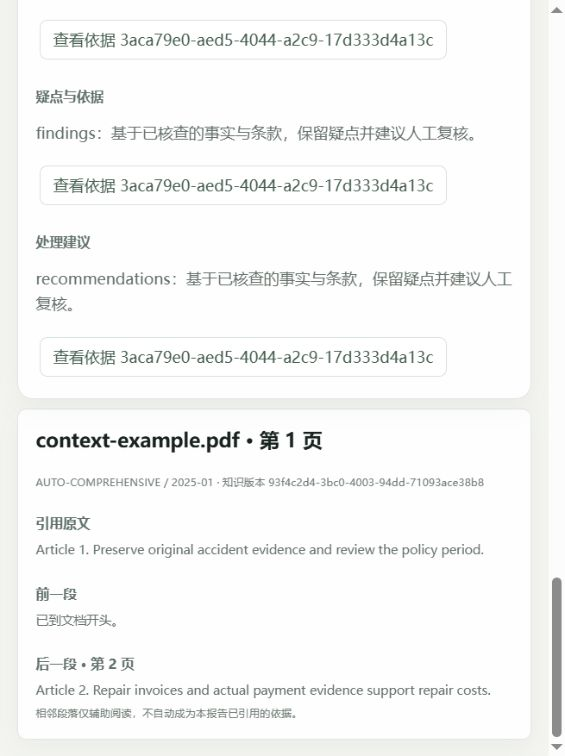

# 2026-10-27 验收记录

## 结论

冻结清单中的功能开发和离线／数据库验证已完成，真实联合验收未通过。不能把项目标为完整 V1 验收完成。

- 后端全量：182 项通过、无跳过，152.73 秒；含新增四个强杀窗口、长历史分页、完整六回合上下文、引用前后段落和评测预算保护。
- 前端／契约：22 项通过（契约 5、前端 17）；契约一致性、类型检查、Vue/Vite 构建、Ruff 检查与格式检查通过。
- 真实能力门禁：未获得可验证模型响应。首次受限环境为 ConnectError；经授权外部网络后为 ReadTimeout，实际等待 30125 ms，公开错误 MODEL_TIMEOUT。
- 累计请求预占：模型 2 次、Embedding 0 次。首轮上限 270，第二轮降为 269，累计不突破用户批准的 270/110。预占数量不表示供应商实际计费，未取得 token 用量。
- 按约定停止，不重试超时请求；未执行真实 Embedding、24 题实际召回、30 个真实报告或真实模型浏览器闭环。

本地浏览器另验证了三页测试 PDF 的引用原文、前一段首边界、下一段实际原文及页码；使用测试适配器，不替代真实模型门禁。

本次使用既定 glm-4.7-flash / embedding-3 / 1024 维，没有替换模型、放宽门禁或修改冻结标签。数据哈希与白名单错误记录位于本目录的两个运行子目录。

## T01–T26 证据表

“离线通过”表示对应的确定性或真实数据库集成证据成立，不表示真实模型语义质量通过。

| ID | 当前证据 | 真实联合状态 |
| --- | --- | --- |
| T01 | 最小请求已执行，连接失败后获准联网，随后 30 秒读取超时；请求账本保留 | 失败，后续门禁阻塞 |
| T02 | Tools Schema、工具执行、非法参数及模型补检图测试通过 | 未执行，依赖 T01 |
| T03 | 缺件、重复材料来源、缺失／非法／冲突日期规则与原值证据测试通过 | 规则层通过，真实样例联合核验未执行 |
| T04 | 多页文字、分块、页码、空白、扫描、加密、损坏与超限 PDF 测试通过 | 支持格式边界通过，不支持 OCR |
| T05 | 实际 vector(1024) 写入与查询、profile／维度拒绝通过；向量来自替身 | 实际供应商 Embedding 未执行 |
| T06 | 险种／版本／generation／profile 查询隔离和 FK 约束通过 | 真实向量题集未执行 |
| T07 | 发布 CAS、第 N 批失败、中间态强杀、显式重试与旧发布保留通过 | 真实 Embedding 链路未执行 |
| T08 | 固定上下文、旧 generation 重载及旧来源读取测试通过；新相邻块查询按原 generation 隔离 | 真实报告后替换与追问未执行 |
| T09 | 24 题与页码标签已冻结并通过 PDF 映射检查 | Hit@4 未测，不得报告达标 |
| T10 | 证据不足结构分支、无新增依据停止和引用白名单通过 | 无答案语义行为未执行 |
| T11 | 持久调用预占、8/3/1 上限、报告额度预留、补检停止、强杀后预算保留通过 | 真实模型补检样例未执行 |
| T12 | 错误结构、越界事实／引用、一次逻辑修复与未验证结果不定稿通过 | 实际模型结构输出未通过前置门禁 |
| T13 | 评测保存实际片段和报告的工具已完成，不用 ID 合法代替语义支持 | 无真实报告可审查，未执行 |
| T14 | 实际图逐节调用替身；延迟后续章节时首节可见；中间失败不定稿；恢复不重生成已提交节 | 真实模型增量未执行 |
| T15 | 执行 ID、开始／完成／失败／尝试记录与前端归并通过 | 模型调用行为仍待真实联合检查 |
| T16 | 真实 TCP、快照后接流、Header 优先、断流重取快照、去重及缺号处理通过 | 协议层通过，真实服务场景未执行 |
| T17 | 非法／过大游标和终态补发关闭测试通过；心跳不占序号的实现保留 | 真实供应商场景未执行 |
| T18 | 真实 Vue 生命周期检查旧 HTTP/SSE/catch/finally 隔离；数据库会话隔离通过 | 真实模型多会话快切未执行 |
| T19 | 新 analysisId、原报告保留、六个完整回合、失败回合排除、相同时间戳不拆回合通过 | 两轮真实追问未执行 |
| T20 | 活动任务唯一约束、待审冲突、不同会话隔离通过 | 数据库层通过 |
| T21 | 通过／驳回／直达、真实 checkpoint 中断、保留规则疑点与驳回无报告通过 | 浏览器流程用测试适配器验证，真实模型未执行 |
| T22 | 独立 API 强杀后，原任务与审核点恢复，第三次启动快照一致 | 持久恢复层通过 |
| T23 | 相同键重试、不同内容冲突、并发相反决定与过期版本拒绝通过 | 事务／协议层通过 |
| T24 | 审核入库未恢复、checkpoint 中断未投影、章节已入库、模型返回未落库四个独立进程强杀窗口通过 | 外部真实请求窗口未执行；不声称全局 exactly-once |
| T25 | 历史读取、任务引用越界拒绝、原文／页码／前后段落；实体数据来自数据库 | 页面验证用测试适配器，真实报告溯源未执行 |
| T26 | 缺配置、数据库错误脱敏、模型超时、Embedding 失败和文本输出边界测试通过；本次真实超时已安全停止 | 真实文档提示注入和 HTML 联合样例未执行 |

## 可复核材料

- [冻结实施清单](../开发/剩余功能实施清单.md) 与 [真实验收工具说明](../开发/真实验收使用说明.md)。
- [首次运行摘要](2026-10-27完整验收/results.json) 与 [预占账本](2026-10-27完整验收/provider-calls.json)。
- [联网运行摘要](2026-10-27联网验收/results.json)、[能力错误](2026-10-27联网验收/capabilities.json) 与 [预占账本](2026-10-27联网验收/provider-calls.json)。
- 固定数据：`tests/evaluation/corpus.json`、`retrieval.json`、`reports.json`；运行摘要保存对应 SHA256。

## 后续条件

需要恢复已选真实服务的可用性，再显式恢复真实验收；本轮失败后不会后台继续消耗剩余额度。真实 Embedding、Hit@4、关键结论语义支持与真实浏览器闭环仍须逐项完成，不以现有测试适配器替代。
